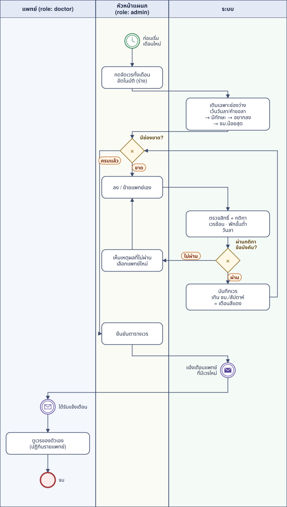
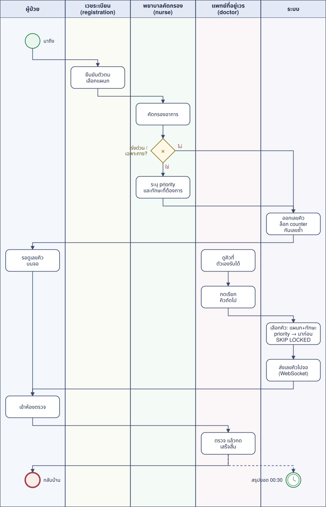
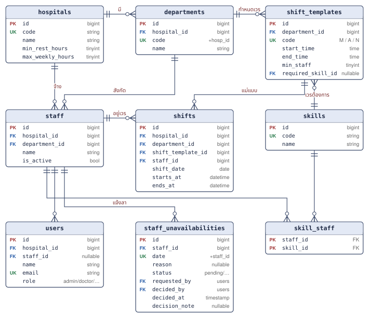
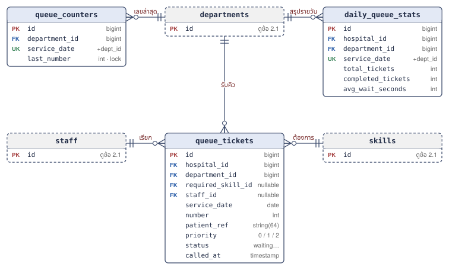
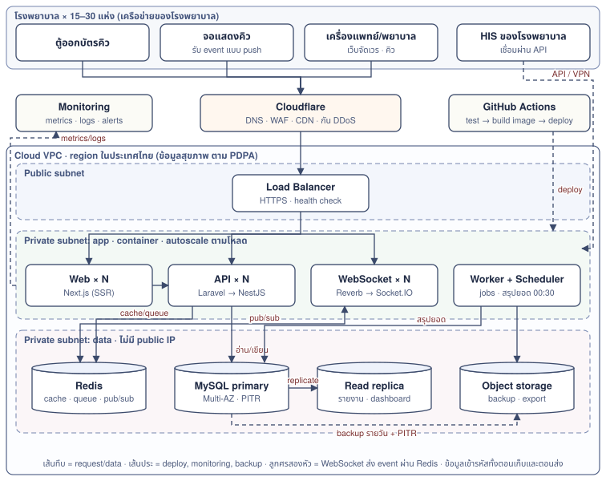
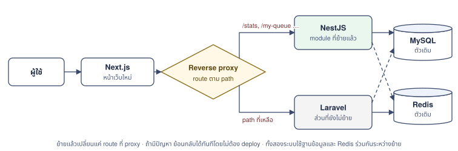

# ระบบจัดเวรแพทย์และจัดคิวโรงพยาบาล — Architecture

จิตฤดี ดวงดี · 27 ต.ค. 2569 · โค้ด: [github.com/JitrudeeDongdee/waka-crud](https://github.com/JitrudeeDongdee/waka-crud) · เดโม: [jitrudeedongdee.github.io/waka-crud](https://jitrudeedongdee.github.io/waka-crud/)

เอกสารนี้อธิบาย 4 เรื่องของระบบที่เริ่มจาก 15 โรงพยาบาลและขยายไปถึง 30 แห่ง ได้แก่ ขั้นตอนการทำงาน (BPMN), โครงสร้างฐานข้อมูล (ER diagram), โครงสร้าง server และ network ตอนขยายขึ้น cloud และแผนย้ายจาก PHP/Laravel ไปเป็น Next.js + NestJS

**สรุปสั้น**

- **งานหลักคือการจัดเวรแพทย์รายเดือน** ส่วนคิวผู้ป่วยเป็นงานที่ใช้ตารางเวรต่อ ระบบจึงต้องรู้ว่าแพทย์คนไหนอยู่เวรเมื่อไหร่ และมีความเชี่ยวชาญอะไร
- **ผู้ใช้แต่ละบทบาททำได้ไม่เท่ากัน** (แอดมิน / แพทย์ / พยาบาล / เวชระเบียน) และเห็นได้เฉพาะข้อมูลของโรงพยาบาลตัวเอง ตรวจสิทธิ์ที่ backend ทุก request
- **ขนาดข้อมูลไม่ใช่ปัญหาหลัก** ต่อให้ขยายถึง 30 แห่ง ก็ประมาณ 33 ล้านคิวต่อปี MySQL เครื่องเดียวรองรับได้ ถ้า index ถูกและแบ่ง partition ตามเดือน **ที่หนักจริงคือจอแสดงคิว** ที่ต้องอัปเดตพร้อมกันหลายร้อยจอ จึงควรใช้ WebSocket ไม่ใช่ polling
- **ย้ายไป Next.js + NestJS แบบค่อย ๆ ทำ (strangler fig)** ทีละส่วน ระบบเดิมยังใช้งานได้ตลอด เริ่มจากหน้าเว็บก่อน แล้วค่อยย้าย API ทีละ module ส่วนที่เสี่ยงที่สุด (การออกและเรียกคิว) ย้ายเป็นอันดับสุดท้าย

---

## 1. ขั้นตอนการทำงาน (BPMN)

ผังใช้สัญลักษณ์ BPMN: วงกลมเขียว = เหตุการณ์เริ่ม (มีนาฬิกา = เริ่มตามเวลา) · วงกลมแดงขอบหนา = จบ · สี่เหลี่ยมมุมมน = งาน · ข้าวหลามตัด × = ทางแยก · เส้นประ = ส่งข้อมูลต่อ · แต่ละคอลัมน์ = ผู้รับผิดชอบหนึ่งบทบาท (swimlane)

### 1.1 วางตารางเวรรายเดือน

แอดมินกดจัดเวรทั้งเดือนเป็นร่าง ระบบเติมเฉพาะช่องที่ว่าง จากนั้นแอดมินปรับเองได้ ทุกครั้งที่ลงเวร ระบบตรวจทั้งสิทธิ์และกติกา ถ้าผิดจะบอกเหตุผลกลับมา จัดเวรทั้งเดือนของแผนกที่มีแพทย์ 6 คน (124 เวร) ใช้เวลาประมาณ 0.4 วินาที

### 1.2 วันให้บริการ: ผู้ป่วยมาถึงจนตรวจเสร็จ

**กติกาทางธุรกิจที่ผังนี้บังคับใช้**

| กติกา | อยู่ในโค้ดที่ |
|---|---|
| แพทย์ห้ามมีเวรซ้อนกัน ต้องพักอย่างน้อย 8 ชม. ระหว่างเวร (ตั้งได้ต่อโรงพยาบาล) | `RosterService::check()` |
| ทำงานไม่เกิน 60 ชม./สัปดาห์ (ตั้งได้ต่อโรงพยาบาล) แม้จัดเป็นรายเดือน | `RosterService::check()` |
| ห้ามลงเวรในวันที่แพทย์แจ้งลา | `RosterService::check()` |
| ตู้คิว/เวชระเบียนออกบัตรได้ แต่กำหนดความเร่งด่วนได้เฉพาะพยาบาลคัดกรอง | `TicketController::store()` |
| แพทย์เรียกคิวและบันทึกวันลาได้เฉพาะของตัวเอง | `TicketController`, `RosterController` |
| แต่ละเวรต้องมีแพทย์ครบจำนวนขั้นต่ำ และมีแพทย์ที่มีความเชี่ยวชาญที่เวรนั้นต้องการ | `RosterService::coverageProblem()` |
| เลขคิวรันใหม่ทุกวันแยกแต่ละแผนก ไม่ซ้ำ แม้หลายตู้กดพร้อมกัน | `QueueService::issue()` |
| แพทย์ได้เฉพาะคิวที่ตัวเองรับได้ เคสเร่งด่วนก่อน แล้วมาก่อนได้ก่อน | `QueueService::callNext()` |
| ข้อมูลของโรงพยาบาลหนึ่งเข้าถึงจากอีกโรงพยาบาลไม่ได้ | `Route::scopeBindings()` ใน `routes/api.php` |

---

## 2. ฐานข้อมูล (ER diagram)

ตาราง `users` เก็บบทบาท (`role`) และโรงพยาบาลที่สังกัด ถ้าผู้ใช้เป็นแพทย์จะผูกกับ `staff` ด้วย ทุกตารางที่เป็นข้อมูลของโรงพยาบาลจะมี `hospital_id` หรือผูกกับ `department` ที่มี `hospital_id` อยู่ เพื่อให้แยกข้อมูลได้ (multi-tenant แบบใช้ฐานข้อมูลเดียวกัน) และไม่เก็บชื่อหรือเลขบัตรผู้ป่วย เก็บแค่รหัสอ้างอิง (`patient_ref`) ที่ไปเชื่อมกับระบบ HIS ของโรงพยาบาล

### 2.1 จัดเวรแพทย์

### 2.2 คิวผู้ป่วยและสถิติ

กรอบเส้นประ = ตารางจากข้อ 2.1 · ขีดคู่ = ฝั่ง "หนึ่ง" · ตีนกา + วงกลม = ฝั่ง "ศูนย์ถึงหลาย"

**Index ที่ออกแบบตาม query จริง** (ตรวจด้วย `EXPLAIN` บน MySQL 8.4 กับข้อมูล 200,000 คิวแล้ว ไม่มี filesort)

| Query | Index | เหตุผล |
|---|---|---|
| เรียกคิวถัดไป | `queue_tickets (department_id, service_date, status, priority DESC, id)` | ตรงกับ `WHERE` + `ORDER BY priority DESC, id` ทั้งชุด อ่านแถวแรกได้ทันที |
| รายการคิวของโรงพยาบาล (keyset) | `queue_tickets (hospital_id, service_date, id)` | ไม่มี `status` คั่นกลาง `ORDER BY id` จึงไม่ต้อง sort ซ้ำ |
| ตรวจกติกาเวรของแพทย์ | `shifts (staff_id, starts_at)` | หาเวรที่อยู่ใกล้กันในช่วงเวลาพักได้ด้วย range scan |
| ตารางเวรของแผนก | `shifts (department_id, shift_date)` | ดึงทั้งเดือนได้ในครั้งเดียว |
| Dashboard | `daily_queue_stats (hospital_id, service_date)` | อ่านจากตารางสรุป ไม่ต้อง `COUNT` จากคิวหลายล้านแถว |

### 2.3 สิทธิ์ตามบทบาท (RBAC)

สิทธิ์ทั้งหมดกำหนดไว้ที่เดียวใน `App\Enums\Role` ฝั่ง backend ใช้เป็น Laravel Gate (`->middleware('can:roster.manage')`) ส่วนหน้าเว็บอ่านจาก `/api/me` เพื่อซ่อนปุ่ม ถึงหน้าเว็บจะซ่อนปุ่มแล้ว backend ก็ยังตรวจซ้ำทุก request

| สิทธิ์ | แอดมิน / หัวหน้าแผนก | แพทย์ | พยาบาล | เวชระเบียน / ตู้คิว |
|---|:-:|:-:|:-:|:-:|
| ดูตารางเวร | ✓ | ✓ | ✓ | |
| จัดเวร / จัดอัตโนมัติ / ลบเวร | ✓ | | | |
| บันทึกวันลา | ทุกคน | ของตัวเอง | | |
| ดูรายการคิว | ✓ | ✓ | ✓ | |
| ออกบัตรคิว | ✓ | | ✓ | ✓ |
| กำหนดความเร่งด่วน / ความเชี่ยวชาญ (คัดกรอง) | ✓ | | ✓ | |
| เรียกคิว / ตรวจเสร็จ | | ของตัวเอง | | |
| ดูสถิติ | ✓ | | | |

**ตรวจ 3 ชั้น:** (1) ล็อกอินแล้ว (Sanctum token) → 401, (2) สังกัดโรงพยาบาลใน URL (`EnsureHospitalMember`) → 403 และ id ของโรงพยาบาลอื่นที่ใส่ใน URL → 404 (`scopeBindings`), (3) มีสิทธิ์ของ action นั้น และเป็นเจ้าของข้อมูลถ้าสิทธิ์จำกัดแค่ "ของตัวเอง" → 403 · มีชุดทดสอบ 9 ข้อสำหรับเรื่องนี้โดยเฉพาะ (`AuthorizationTest`)

**ผู้ใช้ทดลอง:** เดโมให้เลือกผู้ใช้โดยไม่ต้องใช้รหัสผ่าน ซึ่งเปิดได้เฉพาะเมื่อตั้ง `DEMO_LOGIN=true` ค่าเริ่มต้นปิดอยู่ ระบบจริงต้องใช้ SSO ของโรงพยาบาลหรือรหัสผ่าน + MFA

---

## 3. Network และ Server

### 3.1 ขนาดงานที่ต้องรองรับ (ประมาณการ)

ตัวเลขข้างล่างเป็น**สมมติฐาน** ต้องยืนยันกับข้อมูลจริงของลูกค้า

| รายการ | 15 แห่ง (เริ่มต้น) | 30 แห่ง |
|---|---|---|
| คิวต่อวัน (สมมติ 3,000 คิว/แห่ง) | 45,000 | 90,000 |
| แถว `queue_tickets` ต่อปี | ~16 ล้าน | ~33 ล้าน (~15–20 GB รวม index) |
| การเขียนช่วงพีค 08:00–10:00 (ออกคิว + เรียก + เสร็จ) | ~5 ครั้ง/วินาที | ~10 ครั้ง/วินาที |
| จอแสดงคิว (สมมติ 20 จอ/แห่ง) | 300 จอ | 600 จอ |
| ถ้าจอ polling ทุก 5 วินาที | 60 request/วินาที | 120 request/วินาที (เกือบทั้งหมดได้ "ไม่มีอะไรเปลี่ยน") |
| แถว `shifts` ต่อปี | ~0.3 ล้าน | ~0.65 ล้าน |

**ข้อสรุป:** งานเขียนข้อมูลมีน้อย ฐานข้อมูลเครื่องเดียวรองรับได้สบาย ส่วนที่หนักคือ**การอ่านซ้ำ ๆ จากจอแสดงคิว** จึงต้อง (1) ส่งข้อมูลแบบ push ผ่าน WebSocket แทนการ polling, (2) cache ข้อมูลที่อ่านบ่อยใน Redis และ (3) แยก replica ไว้ให้รายงานกับ dashboard อ่าน

### 3.2 Architecture เป้าหมายบน cloud

**ทำไมออกแบบแบบนี้**

- **ทุก tier ของ app ไม่เก็บ state ไว้ที่เครื่อง (stateless):** session, cache และ job อยู่ใน Redis ทั้งหมด จึงเพิ่มหรือลดจำนวน container ได้ตามโหลดช่วงเช้า
- **WebSocket แยกเป็น tier ของตัวเอง:** API เขียนข้อมูลเสร็จก็ publish event เข้า Redis จากนั้น WebSocket ทุกตัวส่งต่อไปยังจอที่ subscribe channel ของโรงพยาบาลและแผนกนั้น เพิ่มจำนวนเครื่องได้โดยไม่ต้องใช้ sticky session ข้ามเครื่อง
- **ฐานข้อมูลไม่มี public IP:** เข้าถึงได้จาก subnet ของ app เท่านั้น ข้อมูลสุขภาพเป็นข้อมูลอ่อนไหวตาม PDPA มาตรา 26 ต้องเข้ารหัสทั้งตอนเก็บและตอนส่ง มี audit log และให้สิทธิ์เท่าที่จำเป็น
- **Backup + Point-in-time recovery:** เป้าหมายคือข้อมูลหายได้ไม่เกิน 5 นาที (RPO) และกู้ระบบกลับมาได้ภายใน 1 ชั่วโมง (RTO) ต้องตกลงกับลูกค้าอีกครั้ง
- **จอแสดงคิวต้องใช้ต่อได้ตอนเน็ตหลุดสั้น ๆ:** จอแสดงข้อมูลล่าสุดค้างไว้ พอต่อกลับได้ก็ดึงสถานะล่าสุดใหม่

**เลือก cloud:** ทั้ง AWS (ECS Fargate + RDS MySQL + ElastiCache) และ GCP (Cloud Run + Cloud SQL + Memorystore) ใช้ได้ทั้งคู่ เกณฑ์เลือก: (1) มี region ในไทยไหม เพราะข้อมูลสุขภาพอาจต้องเก็บในประเทศ ต้องตรวจสอบสถานะของแต่ละเจ้า ณ วันที่เลือก, (2) ทีมคุ้นกับเจ้าไหน และ (3) ราคาเทียบกับปริมาณงานจริง ตอนนี้ระบบรันเป็น container อยู่แล้ว (`docker-compose.yml`) ย้ายไปเจ้าไหนก็ได้

### 3.3 ขยายระบบเป็นขั้น

ขยายเมื่อตัวชี้วัดถึงเกณฑ์ ไม่ใช่ทำทุกอย่างตั้งแต่วันแรก

| ขั้น | เมื่อไหร่ | ทำอะไร |
|---|---|---|
| 0. ตอนนี้ | เดโม / pilot 1–2 แห่ง | VM เครื่องเดียว + docker compose, MySQL, backup รายวัน, CI/CD (มีแล้ว) |
| 1. ขึ้น cloud | ก่อนเปิดใช้ 15 แห่ง | Managed MySQL (Multi-AZ), Redis, API 2 ตัวขึ้นไปหลัง Load Balancer, worker แยก, monitoring + alert, WebSocket แทน polling |
| 2. ขยาย | ใกล้ 30 แห่ง หรือ CPU ของ DB > 60% ช่วงพีค | Autoscale ตาม CPU/latency, read replica ให้รายงาน, แบ่ง `queue_tickets` เป็น partition รายเดือน, archive ข้อมูลเก่าตามนโยบายเก็บข้อมูลของโรงพยาบาล |
| 3. เกินแผนเดิม | > 100 แห่ง หรือลูกค้าต้องการแยกฐานข้อมูล | แยกฐานข้อมูลเป็นกลุ่มโรงพยาบาล (shard ตาม `hospital_id`) หรือแยก DB ต่อรายสำหรับลูกค้าใหญ่ |

**ตัวชี้วัดที่ต้องดู:** latency p95 ของ API เรียกคิว (เป้า < 200 ms), CPU และจำนวน connection ของ DB, ความล่าช้าของ replica, ความยาวของ job queue, จำนวน WebSocket ที่เชื่อมต่ออยู่ และจำนวนครั้งที่ deploy แล้วล้ม

---

## 4. แผนย้ายจาก PHP/Laravel ไป Next.js + NestJS

### 4.1 ภาษาและเครื่องมือที่แนะนำ

ใช้ **TypeScript ทั้งระบบ** เพื่อให้หน้าเว็บกับ API ใช้ type ชุดเดียวกัน และทีมเดียวทำได้ทั้งสองฝั่ง

| ส่วน | ตอนนี้ (Laravel) | หลังย้าย | หมายเหตุ |
|---|---|---|---|
| หน้าเว็บ | React 19 + Vite ใน Laravel | **Next.js (App Router)** | ใช้ component เดิมได้เกือบทั้งหมด |
| API | Laravel controller + service | **NestJS** (module, controller, service) | โครงสร้างคล้าย Laravel มาก ย้ายทีละ module ได้ |
| ORM / migration | Eloquent + migration | **Prisma** (หรือ TypeORM) | ต้องให้มีระบบเดียวเท่านั้นที่เป็นเจ้าของ schema |
| Validation | Form Request | **class-validator** หรือ **Zod** | แชร์ schema กับหน้าเว็บได้ |
| Job / scheduler | Laravel Queue + Scheduler | **BullMQ** + `@nestjs/schedule` | ใช้ Redis ตัวเดิม |
| Real-time | Laravel Reverb | **Socket.IO** + Redis adapter | ใช้ channel ชื่อเดิม |
| Auth | Sanctum | **JWT / OIDC** (เช่น Keycloak) | ทั้งสองระบบต้องใช้ token ร่วมกันได้ในช่วงที่ยังย้ายไม่เสร็จ |
| สิทธิ์ | `Role` enum + Gate + middleware | **Guard + `@Roles()`/`@Permissions()` decorator** (หรือ CASL) | ย้าย map บทบาท×สิทธิ์เดิมไปเป็นไฟล์ที่ทั้งสองระบบอ่านร่วมกันได้ |
| ทดสอบ | PHPUnit (28 ข้อ, HTTP level) | **Jest** + Supertest, **Playwright** | ชุดทดสอบเดิมเป็น contract ที่ API ใหม่ต้องผ่าน |
| โครงสร้าง repo | repo เดียว | **monorepo** (pnpm + Turborepo): `apps/web`, `apps/api`, `packages/types` | type ของ API สร้างจาก OpenAPI |

### 4.2 วิธีย้าย: Strangler fig

ไม่เขียนใหม่ทั้งหมดในครั้งเดียว วาง reverse proxy ไว้ข้างหน้า แล้วค่อย ๆ ส่ง request ทีละ path ไปที่ NestJS พอย้ายครบก็ปิด Laravel

### 4.3 ขั้นตอน

| ขั้น | งาน | เสร็จเมื่อ | ความเสี่ยง |
|---|---|---|---|
| 0. เตรียม (ทำใน Laravel) | สร้าง OpenAPI spec ของ API ทุกตัว, เปลี่ยนชุดทดสอบ HTTP ให้เป็น contract test ที่ยิงไป URL ไหนก็ได้, ย้าย logic ทั้งหมดเข้า service (ตอนนี้ทำแล้ว) | contract test ผ่านกับ Laravel | ต่ำ |
| 1. หน้าเว็บ → Next.js | ย้าย React เดิมเข้า Next.js ให้เรียก API Laravel ตัวเดิม | ผู้ใช้ไม่เห็นความต่าง, E2E (Playwright) ผ่าน | ต่ำ (ย้อนกลับได้ที่ DNS) |
| 2. วางโครง NestJS | monorepo, auth แบบใช้ token ร่วมกัน, reverse proxy, CI/CD, monitoring | request ทดสอบผ่าน proxy ไปถึง NestJS | ต่ำ |
| 3. ย้ายส่วนที่อ่านอย่างเดียว | สถิติ/dashboard, คิวของแพทย์ (`my-queue`), ข้อมูลอ้างอิง | contract test ผ่านกับ NestJS, latency ไม่แย่ลง | ต่ำ |
| 4. ย้ายจัดเวร | ตรวจกติกา, จัดเวรทั้งเดือนอัตโนมัติ, วันลา | ทดสอบจัดเวร 11 ข้อผ่าน และเทียบผลจัดเวรกับระบบเดิมด้วยข้อมูลจริงย้อนหลัง | กลาง (กติกาซับซ้อน) |
| 5. ย้ายคิว (ส่วนที่เสี่ยงที่สุด) | ออกคิว (lock counter), เรียกคิว (`SKIP LOCKED`), WebSocket | load test ช่วงพีคผ่าน, ไม่มีเลขคิวซ้ำ, ไม่มีคิวที่สองห้องได้พร้อมกัน | สูง → ย้ายทีละโรงพยาบาลด้วย feature flag |
| 6. job + ปิดระบบเดิม | สรุปยอดรายวัน, ลบข้อมูลเก่า → BullMQ, แล้วปิด Laravel | ไม่มี request ไป Laravel 2 สัปดาห์ | ต่ำ |

**ข้อควรระวัง**

- **ช่วงที่สองระบบใช้ฐานข้อมูลเดียวกัน ต้องมีระบบเดียวที่เป็นเจ้าของ migration** (เสนอให้ Laravel เป็นเจ้าของจนถึงขั้น 5 แล้วค่อยส่งต่อให้ Prisma ด้วย `prisma db pull`) ถ้าสองระบบแก้ schema พร้อมกัน ข้อมูลจะพังได้
- **ย้ายทีละ endpoint ต้อง rollback ได้ทันที:** แค่แก้ route ที่ proxy ไม่ต้อง deploy ใหม่
- **อย่าย้ายพร้อมเพิ่มฟีเจอร์:** API ใหม่ต้องให้ผลเหมือนเดิมก่อน ค่อยปรับปรุงทีหลัง
- **ไม่ต้องหยุดพัฒนาฟีเจอร์ระหว่างย้าย:** ฟีเจอร์ใหม่ให้เขียนใน NestJS ตั้งแต่ขั้น 2 เป็นต้นไป

### 4.4 สิ่งที่ควรเริ่มทำตั้งแต่ตอนนี้ (ยังเป็น PHP อยู่)

- ทำแบบ API-first: หน้าเว็บคุยกับระบบผ่าน JSON API อย่างเดียว ไม่ใช้ Blade render ข้อมูล (repo นี้ทำแบบนี้แล้ว)
- เขียน logic ไว้ใน service ไม่ใช่ใน controller (`QueueService`, `RosterService`) ย้ายแล้วเปลี่ยนแค่ภาษา โครงเหมือนเดิม
- ทดสอบที่ระดับ HTTP: ชุดทดสอบเดิมจะกลายเป็น contract ของ API ใหม่ รวมถึงทดสอบสิทธิ์ทุกบทบาท
- ตั้งชื่อ channel ของ event ให้เป็นมาตรฐานตั้งแต่ตอนนี้ เช่น `hospital.{id}.dept.{id}`
- เก็บ config ไว้ใน env และ build เป็น container ทั้งหมด

---

## 5. สิ่งที่ยังไม่ได้ทำใน repo ตัวอย่างนี้

- ล็อกอินจริง (SSO ของโรงพยาบาล หรือรหัสผ่าน + MFA) · ตอนนี้มีแค่ผู้ใช้ทดลองกับระบบสิทธิ์ตามบทบาท
- WebSocket จริง (เดโมยัง polling ทุก 15 วินาที)
- แจ้งเตือนแพทย์เมื่อมีเวรใหม่
- เชื่อมต่อกับ HIS ของโรงพยาบาล (HL7 / FHIR)
- partition ตาราง และ load test ที่ปริมาณ 30 แห่ง
