# ระบบจัดเวรแพทย์และจัดคิวโรงพยาบาล — Architecture

จิตฤดี ดวงดี · 27 ต.ค. 2569 · โค้ด: [github.com/JitrudeeDongdee/hospital-roster-queue](https://github.com/JitrudeeDongdee/hospital-roster-queue) · เดโม: [jitrudeedongdee.github.io/hospital-roster-queue](https://jitrudeedongdee.github.io/hospital-roster-queue/) · ตรงกับเวอร์ชัน v0.7.9

เอกสารนี้อธิบายระบบที่เริ่มจาก 15 โรงพยาบาลและขยายไปถึง 30 แห่ง ได้แก่ ขั้นตอนการทำงาน (BPMN), โครงสร้างฐานข้อมูล (ER diagram), server และ network บน AWS ทีละขั้นของการขยาย, ข้อเสนอฟีเจอร์ถัดไป และหน้าจอเดโม

**สรุปสั้น**

- **งานหลักคือการจัดเวรแพทย์รายเดือน** ส่วนคิวผู้ป่วยเป็นงานที่ใช้ตารางเวรต่อ ระบบจึงต้องรู้ว่าแพทย์คนไหนอยู่เวรเมื่อไหร่ และมีความเชี่ยวชาญอะไร
- **ผู้ใช้แต่ละบทบาททำได้ไม่เท่ากัน** (แอดมิน / แพทย์ / พยาบาล / เวชระเบียน) และเห็นได้เฉพาะข้อมูลของโรงพยาบาลตัวเอง ตรวจสิทธิ์ที่ backend ทุก request
- **รายละเอียดเทคนิคจัดการข้อมูลจำนวนมากพร้อมแหล่งอ้างอิง** อยู่ใน [LARGE-DATA.md](LARGE-DATA.md)
- **ขนาดข้อมูลไม่ใช่ปัญหาหลัก** ต่อให้ขยายถึง 30 แห่ง ก็ประมาณ 33 ล้านคิวต่อปี MySQL เครื่องเดียวรองรับได้ ถ้า index ถูกและแบ่ง partition ตามเดือน **ที่หนักจริงคือจอแสดงคิว** ที่ต้องอัปเดตพร้อมกันหลายร้อยจอ จึงควรใช้ WebSocket ไม่ใช่ polling
- **แพทย์มีส่วนร่วมในตารางเวร:** ส่งเวรที่อยากลง/ไม่สะดวกก่อนจัดร่าง และขอย้ายหรือแลกเวรกับเพื่อนได้เอง เพื่อนตอบรับแล้วสลับทันที ถ้าติดกติกาจึงส่งให้แอดมินเคลียร์ (ข้อ 1.3)
- **หัวหน้าแผนกจัดการแพทย์ได้เอง:** หน้า "แพทย์" แสดงความเชี่ยวชาญ เวรและชั่วโมงเดือนนี้ เวรถัดไป และคำขอลาที่รอของแพทย์ทุกคน เพิ่มแพทย์ใหม่และแก้ความเชี่ยวชาญได้ ตารางเวรและการเรียกคิวใช้ค่าใหม่ทันที
- **หน้าจอเดโมแต่ละกรณี (ข้อ 5):** ภาพหน้าจอจริงของทุกหน้าพร้อมคำอธิบาย ต่อท้ายเอกสาร
- **ข้อเสนอฟีเจอร์ถัดไป (ข้อ 4):** ให้ HR อนุมัติการลาแบบ 2 ขั้น, ประเภทการลาพร้อมกติกาแจ้งล่วงหน้า, วันลาคงเหลือ, แจ้งเตือน LINE/อีเมล และ audit log

---

## 1. ขั้นตอนการทำงาน (BPMN)

### 1.1 วางตารางเวรรายเดือน

### 1.2 ขอลาและอนุมัติการลา

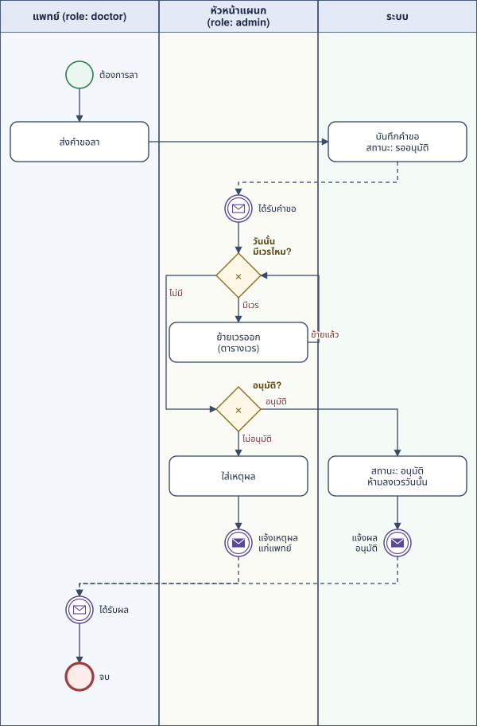

### 1.3 ขอย้ายเวรและแลกเวรกับเพื่อน

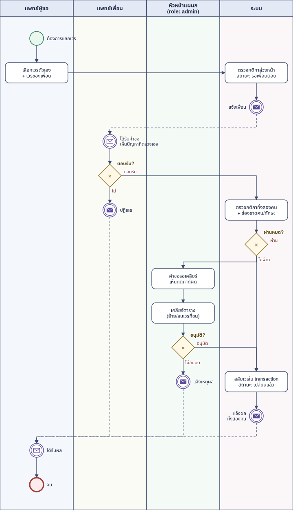

### 1.4 วันให้บริการ: ผู้ป่วยมาถึงจนตรวจเสร็จ

### 1.5 เงื่อนไขข้อบังคับ

| เรื่อง | เงื่อนไข | อยู่ในโค้ดที่ |
|---|---|---|
| กติกาเวร | ห้ามเวรซ้อนเวลา ห้ามลงเวรในวันลาที่อนุมัติแล้ว และห้ามลงเวรของแผนกอื่น (ห้ามเด็ดขาด) | `RosterService::problems()` |
| กติกาเวร | พักอย่างน้อย 8 ชม. ระหว่างเวร และไม่เกิน 60 ชม./สัปดาห์ (ตั้งได้ต่อโรงพยาบาล) · หัวหน้าลงเวรเองที่ผิดข้อนี้ได้ แต่ทุกเวรที่เกี่ยวข้องเป็นชิปสีแดงจนกว่าจะปรับ | `RosterService::problems()`, `shiftWarnings()` |
| กติกาเวร | ทุกช่องต้องมีแพทย์ครบจำนวนขั้นต่ำ และมีแพทย์ที่มีความเชี่ยวชาญที่ช่องนั้นต้องการ | `RosterService::coverageProblem()` |
| จัดเวรอัตโนมัติ | เติมเฉพาะช่องที่ยังว่าง ไม่ลบเวรที่ลงไว้ · เว้นวันลาที่อนุมัติแล้วและที่รออนุมัติ · ไม่ผิดกติกาเวรทุกข้อ | `RosterService::generate()` |
| จัดเวรอัตโนมัติ | ลำดับเลือกแพทย์: มีความเชี่ยวชาญที่ช่องยังขาด → อยากลงช่องนี้ (ไม่สะดวกไว้ท้ายสุด) → ไม่ไปกันช่องอื่นที่ตัวเองอยากลง → ชั่วโมงสะสมน้อยสุด | `RosterService::generate()` |
| จัดเวรอัตโนมัติ | มีแพทย์อยากลงช่องเดียวกันมากกว่าจำนวนที่ต้องการ → ไม่เลือกให้ เว้นช่องไว้ให้หัวหน้าเลือก | `RosterService::contested()` |
| เวรที่อยากลง | ส่ง/แก้ได้จนกว่าแผนกจะมีเวรของเดือนนั้น · วันลา (อนุมัติแล้ว/รออนุมัติ) เลือกไม่ได้ · เกินเพดานชั่วโมงเลือกได้แต่เตือน | `ShiftPreferenceController` |
| การลา | อนุมัติได้เฉพาะเมื่อวันนั้นแพทย์ไม่มีเวร · ไม่อนุมัติต้องแจ้งเหตุผลได้ · แพทย์ยกเลิกได้เฉพาะคำขอที่ยังรออนุมัติ · หัวหน้าบันทึกให้ = อนุมัติทันที | `LeaveController` |
| ย้าย/แลกเวร | ขอได้เฉพาะเวรของตัวเองที่ยังไม่เริ่ม · เวรหนึ่งมีคำขอค้างได้ทีละอัน · ผู้ขอยกเลิกได้ระหว่างรอ | `ShiftRequestController` |
| ย้ายเวร | ช่องใหม่ผิดกติกา = ไม่รับคำขอ · ช่องเดิมจะขาดคน = หัวหน้าตัดสิน · นอกนั้นย้ายทันที | `ShiftRequestController::store()` |
| แลกเวร | เพื่อนตอบรับ และไม่ผิดกติกาของทั้งสองคน และทั้งสองช่องยังครบ = สลับทันทีโดยไม่ต้องรอหัวหน้า · ไม่อย่างนั้นรอหัวหน้าเคลียร์ | `ShiftChangeService::evaluate()` |
| แลกเวร | หัวหน้าอนุมัติไม่ได้ถ้ายังผิดกติกาเวร แต่ยอมรับช่องที่ขาดคนได้ · เปลี่ยนเวรใน transaction ที่ล็อกเวรทั้งสองแถวแล้วตรวจซ้ำ | `ShiftChangeService::apply()` |
| คิว | เลขคิวรันใหม่ทุกวันแยกแผนก ไม่ซ้ำแม้หลายตู้กดพร้อมกัน · ผู้ป่วยเห็นเป็นเลขล้วน 4 หลัก หลักแรก = แผนก | `QueueService::issue()` |
| คิว | ความเร่งด่วน/ความเชี่ยวชาญกำหนดได้เฉพาะพยาบาลคัดกรอง ทั้งตอนออกบัตรและภายหลัง (เฉพาะคิวที่ยังรอเรียก) | `TicketController::store()`, `triage()` |
| คิว | แพทย์ได้เฉพาะคิวที่ตัวเองรับได้ เคสเร่งด่วนก่อน แล้วมาก่อนได้ก่อน · ตรวจได้ทีละคิว ต้องกดเสร็จสิ้นก่อนเรียกคิวถัดไป | `QueueService::callNext()` |
| สิทธิ์ | แพทย์เรียกคิว ขอลา ขอย้าย/แลกเวร และส่งเวรที่อยากลงได้เฉพาะของตัวเอง · ข้อมูลของโรงพยาบาลหนึ่งเข้าถึงจากอีกโรงพยาบาลไม่ได้ | `App\Enums\Role`, `scopeBindings()` |

---

## 2. ฐานข้อมูล (ER diagram)

ตาราง `users` เก็บบทบาท (`role`) และโรงพยาบาลที่สังกัด ถ้าผู้ใช้เป็นแพทย์จะผูกกับ `staff` ด้วย ทุกตารางที่เป็นข้อมูลของโรงพยาบาลจะมี `hospital_id` หรือผูกกับ `department` ที่มี `hospital_id` อยู่ เพื่อให้แยกข้อมูลได้ (multi-tenant แบบใช้ฐานข้อมูลเดียวกัน) และไม่เก็บชื่อหรือเลขบัตรผู้ป่วย เก็บแค่รหัสอ้างอิง (`patient_ref`) ที่ไปเชื่อมกับระบบ HIS ของโรงพยาบาล

### 2.1 จัดเวรแพทย์

**ความสัมพันธ์**
- **โรงพยาบาล → แผนก → ช่วงเวร:** โรงพยาบาลหนึ่งมีหลายแผนก แต่ละแผนกกำหนดช่วงเวรของตัวเอง (`shift_templates` เช่น เช้า/บ่าย/ดึก) พร้อมจำนวนแพทย์ขั้นต่ำ และความเชี่ยวชาญที่ช่วงนั้นต้องมี
- **แพทย์ ↔ ความเชี่ยวชาญ:** แพทย์ (`staff`) สังกัดแผนกเดียว มีได้หลายความเชี่ยวชาญ และความเชี่ยวชาญหนึ่งมีได้หลายคน (many-to-many ผ่าน `skill_staff`)
- **เวร (`shifts`):** 1 แถว = แพทย์ 1 คน อยู่ 1 ช่วงเวรใน 1 วัน จึงผูกกับทั้งแพทย์และช่วงเวร เก็บเวลาเริ่ม/จบจริงไว้ด้วย (เวรดึกข้ามวัน) ใช้ตรวจกติกาพักและชั่วโมงต่อสัปดาห์
- **วันลา (`staff_unavailabilities`):** แพทย์หนึ่งคนลาได้หลายวัน วันละไม่เกิน 1 แถว มีสถานะรออนุมัติ/อนุมัติ/ไม่อนุมัติ และเก็บว่าใครขอและใครตัดสิน
- **บัญชีผู้ใช้ (`users`):** บอกบทบาทและโรงพยาบาลที่สังกัด ถ้าเป็นแพทย์จะผูกกับ `staff` หนึ่งคน (1 ต่อ 1) บทบาทอื่นไม่ผูก

ย้าย/แลกเวร และเวรที่อยากลง (กล่องเส้นประ = ตารางจากผังบน แสดงเฉพาะคอลัมน์ที่เกี่ยว)

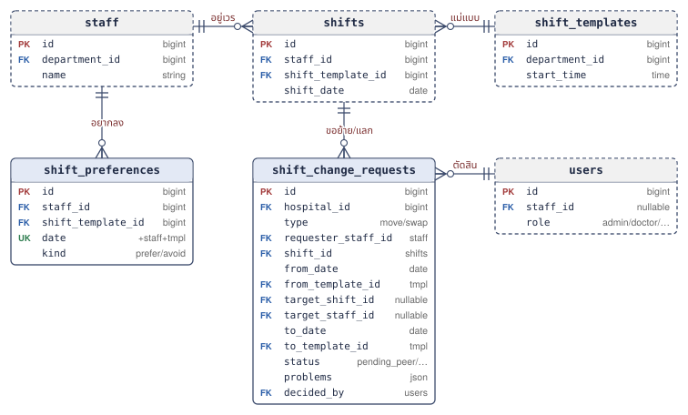

**ความสัมพันธ์**
- **เวรที่อยากลง (`shift_preferences`):** แพทย์หนึ่งคนมีได้หลายแถว 1 แถว = 1 ช่วงเวรใน 1 วัน ว่าอยากลงหรือไม่สะดวก
- **คำขอย้าย/แลก (`shift_change_requests`):** ผูกกับแพทย์ผู้ขอและเวรเดิมของเขาเสมอ ถ้าเป็นการแลก ผูกกับเวรของเพื่อนและตัวเพื่อนด้วย เก็บวันและช่วงเวรต้นทาง/ปลายทางตอนขอไว้ด้วย เพราะหลังสลับแล้ว `shifts` แถวเดิมเปลี่ยนเจ้าของ แต่ประวัติคำขอต้องยังอ่านรู้เรื่อง ถ้าหัวหน้าตัดสิน ผูกกับ `users` ของคนตัดสิน

### 2.2 คิวผู้ป่วยและสถิติ

**ความสัมพันธ์**
- **คิว (`queue_tickets`):** แผนกหนึ่งมีหลายคิว เลขคิวรันใหม่ทุกวันแยกแต่ละแผนก คิวอาจระบุความเชี่ยวชาญที่ต้องการ (ไม่บังคับ) และพอแพทย์เรียกจะผูกกับแพทย์คนนั้น ไม่เก็บชื่อหรือเลขบัตรผู้ป่วย เก็บแค่รหัสอ้างอิงที่ไปเชื่อมกับ HIS
- **ตัวนับเลขคิว (`queue_counters`):** แผนกละ 1 แถวต่อวัน เก็บเลขล่าสุด ล็อกแถวนี้ตอนออกบัตรเพื่อกันเลขซ้ำเมื่อหลายตู้กดพร้อมกัน
- **สรุปรายวัน (`daily_queue_stats`):** แผนกละ 1 แถวต่อวัน สรุปจากคิวดิบทุกคืน ให้ dashboard และปฏิทินรายเดือนอ่านโดยไม่ต้องนับคิวดิบ

กรอบเส้นประ = ตารางจากข้อ 2.1 · ขีดคู่ = ฝั่ง "หนึ่ง" · ตีนกา + วงกลม = ฝั่ง "ศูนย์ถึงหลาย"

### 2.3 สิทธิ์ตามบทบาท (RBAC)

สิทธิ์ทั้งหมดกำหนดไว้ที่เดียวใน `App\Enums\Role` ฝั่ง backend ใช้เป็น Laravel Gate (`->middleware('can:roster.manage')`) ส่วนหน้าเว็บอ่านจาก `/api/me` เพื่อซ่อนปุ่ม ถึงหน้าเว็บจะซ่อนปุ่มแล้ว backend ก็ยังตรวจซ้ำทุก request

| สิทธิ์ | แอดมิน / หัวหน้าแผนก | แพทย์ | พยาบาล | เวชระเบียน / ตู้คิว |
|---|:-:|:-:|:-:|:-:|
| ดูตารางเวร | ✓ | ✓ | ✓ | |
| จัดเวร / จัดอัตโนมัติ / ลบเวร | ✓ | | | |
| บันทึกวันลาให้แพทย์ (อนุมัติทันที) | ✓ | | | |
| ขอลา / ยกเลิกคำขอที่ยังรอ | | ของตัวเอง | | |
| อนุมัติ / ไม่อนุมัติคำขอลา | ✓ | | | |
| ขอย้าย/แลกเวร · ตอบรับคำขอแลก · ส่งเวรที่อยากลง | | ของตัวเอง | | |
| เคลียร์คำขอย้าย/แลกเวรที่ติดกติกา | ✓ | | | |
| จัดการแพทย์: ดูรายละเอียด เพิ่มแพทย์ แก้ชื่อ/ความเชี่ยวชาญ | ✓ | | | |
| ดูรายการคิว | ✓ | ✓ | ✓ | |
| ออกบัตรคิว | ✓ | | ✓ | ✓ |
| กำหนดความเร่งด่วน / ความเชี่ยวชาญ (คัดกรอง) | ✓ | | ✓ | |
| เรียกคิว / ตรวจเสร็จ | | ของตัวเอง | | |
| ดูสถิติ | ✓ | | | |

**ตรวจ 3 ชั้น:** (1) ล็อกอินแล้ว (Sanctum token) → 401, (2) สังกัดโรงพยาบาลใน URL (`EnsureHospitalMember`) → 403 และ id ของโรงพยาบาลอื่นที่ใส่ใน URL → 404 (`scopeBindings`), (3) มีสิทธิ์ของ action นั้น และเป็นเจ้าของข้อมูลถ้าสิทธิ์จำกัดแค่ "ของตัวเอง" → 403 · มีชุดทดสอบสิทธิ์ 9 ข้อ (`AuthorizationTest`) ขั้นตอนการลา 7 ข้อ (`LeaveTest`) และการย้าย/แลกเวรกับเวรที่อยากลง 11 ข้อ (`ShiftRequestTest`)

**ผู้ใช้ทดลอง:** เดโมให้เลือกผู้ใช้โดยไม่ต้องใช้รหัสผ่าน ซึ่งเปิดได้เฉพาะเมื่อตั้ง `DEMO_LOGIN=true` ค่าเริ่มต้นปิดอยู่ ระบบจริงต้องใช้ SSO ของโรงพยาบาลหรือรหัสผ่าน + MFA

---

## 3. Network และ Server

### 3.1 ขนาดงานที่ต้องรองรับ (ประมาณการ)

ตัวเลขข้างล่างเป็น**สมมติฐาน** ต้องยืนยันกับข้อมูลจริงของลูกค้า

| รายการ | 15 แห่ง (เริ่มต้น) | 30 แห่ง |
|---|---|---|
| คิวต่อวัน (สมมติ 3,000 คิว/แห่ง) | 45,000 | 90,000 |
| แถว `queue_tickets` ต่อปี | ≈16 ล้าน | ≈33 ล้าน (≈15–20 GB รวม index) |
| การเขียนช่วงพีค 08:00–10:00 (ออกคิว + เรียก + เสร็จ) | ≈5 ครั้ง/วินาที | ≈10 ครั้ง/วินาที |
| จอแสดงคิว (สมมติ 20 จอ/แห่ง) | 300 จอ | 600 จอ |
| ถ้าจอ polling ทุก 5 วินาที | 60 request/วินาที | 120 request/วินาที (เกือบทั้งหมดได้ "ไม่มีอะไรเปลี่ยน") |
| แถว `shifts` ต่อปี | ≈0.3 ล้าน | ≈0.65 ล้าน |

**ข้อสรุป:** งานเขียนข้อมูลมีน้อย ฐานข้อมูลเครื่องเดียวรองรับได้สบาย ส่วนที่หนักคือ**การอ่านซ้ำ ๆ จากจอแสดงคิว** จึงต้อง (1) ส่งข้อมูลแบบ push ผ่าน WebSocket แทนการ polling, (2) cache ข้อมูลที่อ่านบ่อยใน Redis และ (3) แยก replica ไว้ให้รายงานกับ dashboard อ่าน

### 3.2 ขยายระบบเป็นขั้น

ขยายเมื่อตัวชี้วัดถึงเกณฑ์ ไม่ใช่ทำทุกอย่างตั้งแต่วันแรก

| ขั้น | เมื่อไหร่ | ทำอะไร |
|---|---|---|
| 0. ตอนนี้ | เดโม / pilot 1–2 แห่ง | VM เครื่องเดียว + docker compose, MySQL, backup รายวัน, CI/CD (มีแล้ว) |
| 1. ขึ้น cloud | ก่อนเปิดใช้ 15 แห่ง | Managed MySQL (Multi-AZ), Redis, API 2 ตัวขึ้นไปหลัง Load Balancer, worker แยก, monitoring + alert, WebSocket แทน polling |
| 2. ขยาย | ใกล้ 30 แห่ง หรือ CPU ของ DB > 60% ช่วงพีค | Autoscale ตาม CPU/latency, read replica ให้รายงาน, แบ่ง `queue_tickets` เป็น partition รายเดือน (ต้องยอมเอา foreign key ของตารางนี้ออก และใส่ `service_date` เข้าไปใน primary key ดู [LARGE-DATA.md ข้อ 1.11](LARGE-DATA.md)), archive ข้อมูลเก่าตามนโยบายเก็บข้อมูลของโรงพยาบาล |
| 3. เกินแผนเดิม | > 100 แห่ง หรือลูกค้าต้องการแยกฐานข้อมูล | แยกฐานข้อมูลเป็นกลุ่มโรงพยาบาล (shard ตาม `hospital_id`) หรือแยก DB ต่อรายสำหรับลูกค้าใหญ่ |

**ตัวชี้วัดที่ต้องดู:** latency p95 ของ API เรียกคิว (เป้า < 200 ms), CPU และจำนวน connection ของ DB, ความล่าช้าของ replica, ความยาวของ job queue, จำนวน WebSocket ที่เชื่อมต่ออยู่ และจำนวนครั้งที่ deploy แล้วล้ม

### 3.3 ขั้น 0: ตอนนี้ — เดโม / pilot 1–2 แห่ง

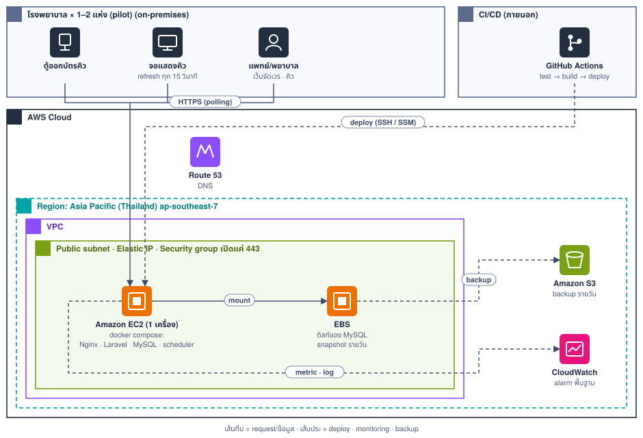

| ส่วน | ทำอะไร |
|---|---|
| Route 53 | DNS ชี้ชื่อโดเมนของระบบไปที่เครื่อง |
| EC2 (1 เครื่อง) | รันทุกอย่างด้วย docker compose: Nginx รับ HTTPS, Laravel (API + หน้าเว็บ), MySQL และ scheduler สรุปยอดคิว |
| EBS | ดิสก์เก็บข้อมูล MySQL ทำ snapshot รายวัน |
| S3 | เก็บไฟล์ backup นอกเครื่อง กู้คืนได้แม้เครื่องเสีย |
| CloudWatch | alarm พื้นฐาน เช่น CPU สูง ดิสก์ใกล้เต็ม เครื่องไม่ตอบ |
| GitHub Actions | รันชุดทดสอบ แล้ว deploy ขึ้นเครื่อง |

### 3.4 ขั้น 1: ขึ้น cloud — ก่อนเปิดใช้ 15 แห่ง

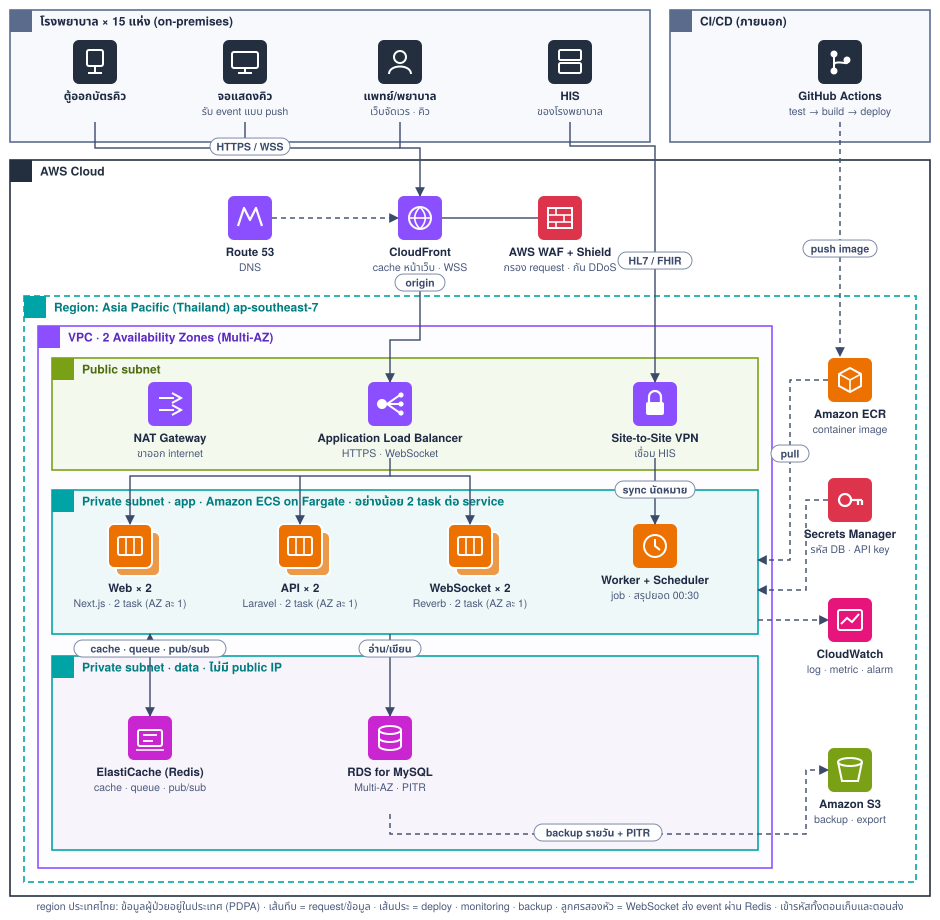

| ส่วน | ทำอะไร | เปลี่ยนจากขั้น 0 เพื่ออะไร |
|---|---|---|
| CloudFront + WAF + Shield | เป็นด่านหน้า cache หน้าเว็บ กรอง request อันตราย กัน DDoS | เปิดใช้หลายโรงพยาบาล ต้องกันการโจมตีก่อนถึงระบบ |
| Application Load Balancer | กระจาย request และ WebSocket ไปยังหลาย container ตรวจว่าตัวไหนพร้อมใช้ | เครื่องเดียวล่มทั้งระบบหยุด · หลายตัวหลัง ALB deploy ได้โดยไม่หยุดระบบ |
| ECS on Fargate | รัน container แยกตามหน้าที่ (Web, API, WebSocket, Worker) อย่างน้อย 2 ตัวต่อหน้าที่ ไม่ต้องดูแลเครื่องเอง | แยกงานออกจากกัน งานหนักอย่างสรุปยอดไม่ไปแย่งทรัพยากรการเรียกคิว |
| WebSocket | ส่งเลขคิวไปจอแสดงคิวทันทีที่มีการเรียก | แทน polling ที่จอหลายร้อยจอยิงถามทุกไม่กี่วินาที |
| Worker + Scheduler | ทำงานเบื้องหลัง: สรุปยอดรายวัน ส่งแจ้งเตือน ดึงนัดหมายจาก HIS | ไม่ให้งานช้าไปถ่วง request ของผู้ใช้ |
| RDS for MySQL (Multi-AZ) | ฐานข้อมูลที่ AWS ดูแล backup + กู้ย้อนเวลาได้ (PITR) มีเครื่องสำรองอีก AZ สลับให้อัตโนมัติ | ไม่ต้องดูแล MySQL เอง และ DB ไม่ล่มตามเครื่องเดียว |
| ElastiCache (Redis) | cache, คิวงานของ Worker และ pub/sub ส่ง event ข้าม container | เมื่อมีหลาย container ต้องมีที่เก็บกลางที่ทุกตัวเห็นเหมือนกัน |
| Site-to-Site VPN | เชื่อมกับ HIS ของโรงพยาบาลแบบเข้ารหัส ไม่เปิดสู่ internet | ดึงนัดหมาย/ข้อมูลผู้ป่วยจาก HIS อย่างปลอดภัย |
| NAT Gateway | ให้ container ใน private subnet ออก internet ได้ (เช่น ส่ง LINE/อีเมล) โดยไม่มีใครเข้ามาได้ | app และ DB ไม่มี public IP |
| ECR · Secrets Manager · CloudWatch | เก็บ container image · เก็บรหัส DB และ API key แทนการใส่ในโค้ด · log, metric และ alarm ของทุกส่วน | deploy ซ้ำได้แบบเดิมทุกครั้ง · รหัสไม่หลุดไปกับโค้ด · เห็นปัญหาก่อนผู้ใช้แจ้ง |

### 3.5 ขั้น 2: ขยาย — ใกล้ 30 แห่ง หรือ CPU ของ DB > 60% ช่วงพีค

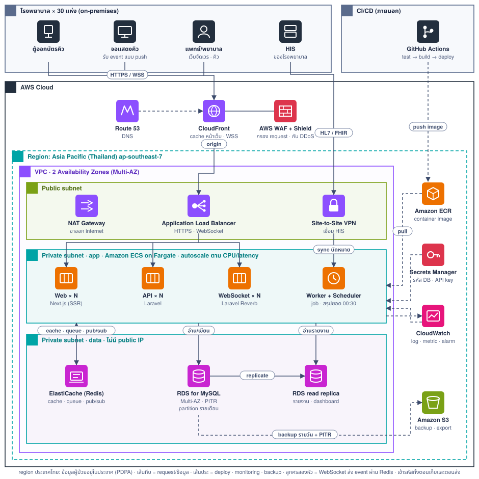

| เพิ่ม/เปลี่ยน | เพื่ออะไร |
|---|---|
| Autoscale ตาม CPU/latency | ช่วงเช้า 08:00–10:00 คนมามาก เพิ่ม container อัตโนมัติ พอบ่ายคนน้อยก็ลดลง จ่ายตามที่ใช้ |
| RDS read replica | รายงานและ dashboard อ่านจากสำเนา ไม่ไปถ่วงฐานข้อมูลหลักที่ใช้ออกและเรียกคิว |
| Partition `queue_tickets` รายเดือน | ตารางคิวโตปีละหลายสิบล้านแถว · query คิววันนี้อ่านแค่ partition ของเดือนนั้น และลบข้อมูลเก่าทั้งเดือนได้ในคำสั่งเดียว |

### 3.6 ขั้น 3: เกินแผนเดิม — มากกว่า 100 แห่ง หรือลูกค้าต้องการแยกฐานข้อมูล

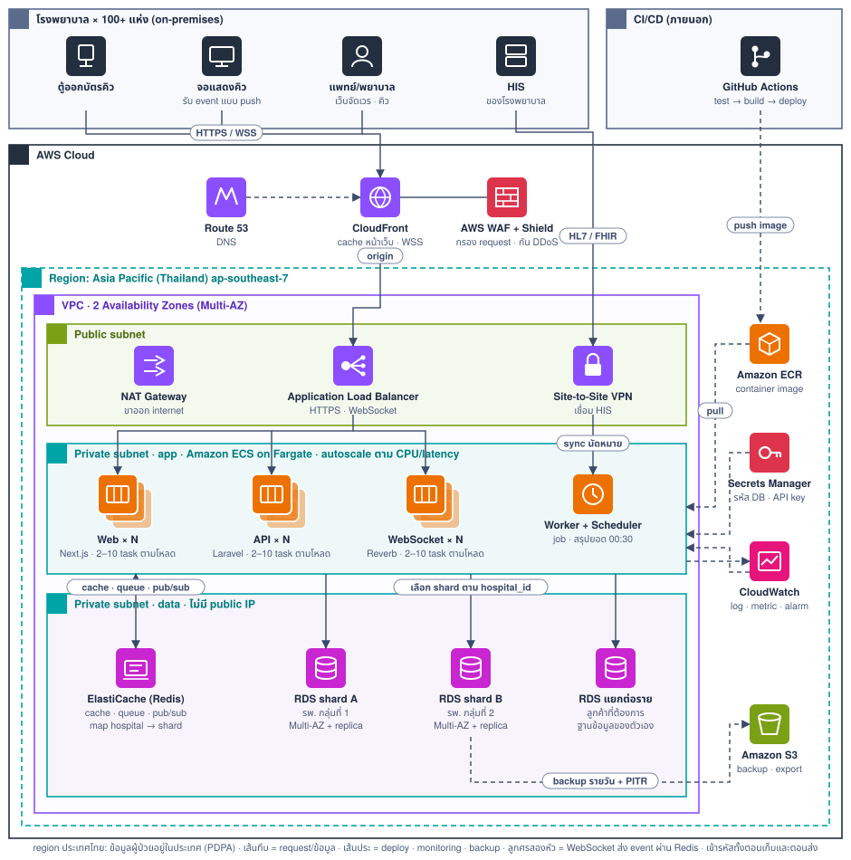

| เพิ่ม/เปลี่ยน | เพื่ออะไร |
|---|---|
| แยก RDS เป็น shard ตามกลุ่มโรงพยาบาล | ฐานข้อมูลก้อนเดียวมีเพดาน · แบ่งกลุ่มโรงพยาบาลไปคนละฐาน ขยายได้ต่อเรื่อย ๆ และปัญหาของกลุ่มหนึ่งไม่กระทบกลุ่มอื่น |
| ElastiCache เก็บ map โรงพยาบาล → shard | API รู้ทันทีว่าข้อมูลของโรงพยาบาลนี้อยู่ฐานไหน ไม่ต้องถามฐานกลางทุก request |
| RDS แยกต่อราย (ลูกค้าใหญ่) | ลูกค้าบางรายต้องการแยกข้อมูลตามสัญญาหรือนโยบาย · แยกทั้ง backup และสิทธิ์เข้าถึงได้ชัดเจน |

### 3.7 ทำไมออกแบบแบบนี้

- **ทุก tier ของ app ไม่เก็บ state ไว้ที่เครื่อง (stateless):** session, cache และ job อยู่ใน Redis ทั้งหมด จึงเพิ่มหรือลดจำนวน container ได้ตามโหลดช่วงเช้า
- **WebSocket แยกเป็น tier ของตัวเอง:** API เขียนข้อมูลเสร็จก็ publish event เข้า Redis จากนั้น WebSocket ทุกตัวส่งต่อไปยังจอที่ subscribe channel ของโรงพยาบาลและแผนกนั้น เพิ่มจำนวนเครื่องได้โดยไม่ต้องใช้ sticky session ข้ามเครื่อง
- **ฐานข้อมูลไม่มี public IP:** เข้าถึงได้จาก subnet ของ app เท่านั้น ข้อมูลสุขภาพเป็นข้อมูลอ่อนไหวตาม PDPA มาตรา 26 ต้องเข้ารหัสทั้งตอนเก็บและตอนส่ง มี audit log และให้สิทธิ์เท่าที่จำเป็น
- **Backup + Point-in-time recovery:** เป้าหมายคือข้อมูลหายได้ไม่เกิน 5 นาที (RPO) และกู้ระบบกลับมาได้ภายใน 1 ชั่วโมง (RTO) ต้องตกลงกับลูกค้าอีกครั้ง
- **จอแสดงคิวต้องใช้ต่อได้ตอนเน็ตหลุดสั้น ๆ:** จอแสดงข้อมูลล่าสุดค้างไว้ พอต่อกลับได้ก็ดึงสถานะล่าสุดใหม่

**ใช้ AWS:** region Asia Pacific (Thailand) `ap-southeast-7` เก็บข้อมูลผู้ป่วยไว้ในประเทศ บริการที่ใช้คือ CloudFront + WAF, ALB, ECS on Fargate, RDS for MySQL, ElastiCache, S3, CloudWatch, ECR, Secrets Manager และ Site-to-Site VPN ต้องตรวจอีกครั้งว่ามีครบใน region นี้ ณ วันที่เริ่มใช้ ถ้าบริการไหนยังไม่มี ให้ใช้ region สิงคโปร์ (`ap-southeast-1`) เฉพาะส่วนที่ไม่เก็บข้อมูลผู้ป่วย

---

## 4. ข้อเสนอฟีเจอร์ถัดไป

ข้อเสนอในส่วนนี้**ยังไม่ได้ทำในโค้ด** ออกแบบให้ต่อยอดจากของเดิมได้โดยไม่ต้องรื้อ ขนาดงานเป็นการประเมินคร่าว ๆ สำหรับนักพัฒนา 1 คน (S = 1–3 วัน, M = 1–2 สัปดาห์, L = มากกว่า 2 สัปดาห์) ส่วนตัวเลขนโยบายการลาทุกตัวเป็นค่าตัวอย่างที่ตั้งได้ต่อโรงพยาบาล **ต้องยืนยันกับ HR ของแต่ละแห่ง** เพราะโรงพยาบาลรัฐใช้ระเบียบการลาของข้าราชการ ส่วนโรงพยาบาลเอกชนใช้กฎหมายคุ้มครองแรงงานและข้อบังคับของบริษัท

### 4.1 ประเภทการลาและกติกาแจ้งล่วงหน้า

ตอนนี้การลามีแบบเดียว ไม่มีกติกาเรื่องเวลา ข้อเสนอคือเพิ่มตาราง `leave_types` ให้ HR ตั้งค่าต่อโรงพยาบาลเอง แล้วระบบตรวจตั้งแต่ตอนแพทย์กดส่ง (ถ้าผิดกติกาตอบ 422 พร้อมเหตุผล เหมือนกติกาจัดเวร)

| คอลัมน์ใน `leave_types` | ความหมาย | ตัวอย่างลาพักร้อน | ตัวอย่างลาป่วย | ตัวอย่างลากิจ |
|---|---|---|---|---|
| `advance_notice_days` | ต้องยื่นล่วงหน้าอย่างน้อยกี่วัน | 7 วัน | 0 (ยื่นย้อนหลังได้ภายใน 3 วัน) | 3 วัน |
| `annual_quota_days` | สิทธิ์ต่อปี | 10 วัน | ตามระเบียบ | 5 วัน |
| `max_consecutive_days` | ลาติดต่อกันได้สูงสุด | 10 วัน | – | 3 วัน |
| `carry_over_max_days` | สะสมไปปีหน้าได้สูงสุด | 10 วัน | 0 | 0 |
| `attachment_required_after_days` | ต้องแนบเอกสารเมื่อลาเกินกี่วัน | – | 3 วัน (ใบรับรองแพทย์) | – |
| `allow_half_day` | ลาครึ่งวันได้ไหม | ได้ | ได้ | ได้ |
| `counts_toward_balance` | หักวันคงเหลือไหม | หัก | หัก | หัก |

**ตัวเลขในตารางเป็นค่าตัวอย่าง ไม่ใช่ข้อกฎหมาย**

**ต้องตกลงกับ HR ก่อนทำ**
- **นับวันแบบไหน:** นับเป็นวันทำการหรือวันปฏิทิน แพทย์ที่อยู่เวรวันหยุดควรนับแบบไหน
- **ลาฉุกเฉิน:** ถ้ามีเหตุฉุกเฉินจนแจ้งล่วงหน้าไม่ทัน ให้ HR อนุมัติข้ามกติกาได้ แต่ต้องใส่เหตุผลและเก็บไว้ใน audit log
- **ใบรับรองแพทย์:** เป็นข้อมูลสุขภาพที่อ่อนไหวตาม PDPA ต้องเก็บใน object storage แบบเข้ารหัส และให้เฉพาะ HR เปิดดูได้

ขนาดงาน: **M**

### 4.2 วันลาคงเหลือ

แสดงวันลาคงเหลือในฟอร์มก่อนกดส่ง และไม่ให้ส่งถ้าวันลาไม่พอ หรือยอมให้ติดลบตามนโยบาย เสนอให้เพิ่มตาราง `leave_balances` แยกตามแพทย์ × ประเภทการลา × ปี

| คอลัมน์ | ความหมาย |
|---|---|
| `entitled` | สิทธิ์ของปีนั้น (คำนวณตามสัดส่วนสำหรับคนที่เข้างานกลางปี) |
| `carried_over` | ยกมาจากปีก่อน (ไม่เกิน `carry_over_max_days`) |
| `reserved` | กันไว้สำหรับคำขอที่ยังรออนุมัติ |
| `used` | ใช้ไปแล้ว (อนุมัติแล้ว) |
| คงเหลือ | `entitled + carried_over − used − reserved` |

**วงจรของวันลา:** ส่งคำขอ → ย้ายเข้า `reserved` · ไม่อนุมัติหรือยกเลิก → คืนจาก `reserved` · อนุมัติ → ย้ายจาก `reserved` ไป `used` · ยกเลิกหลังอนุมัติ (ถ้านโยบายอนุญาต) → คืนจาก `used`

**ข้อควรระวัง**
- **กันแพทย์ส่งคำขอพร้อมกันจนวันลาติดลบ:** ล็อกแถว balance ใน transaction เดียวกับการบันทึกคำขอ แบบเดียวกับที่ใช้ล็อกเลขคิวใน `QueueService::issue()`
- **ปรับยอดด้วยมือ:** HR ปรับยอดเองได้ แต่ต้องใส่เหตุผลและเก็บใน audit log
- **ขึ้นปีใหม่:** มี scheduled job ยกยอดวันลาไปปีถัดไป (`schedule:run` เหมือนงานสรุปยอดคิว)

**API ที่ต้องเพิ่ม**
- `GET /staff/{staff}/leave-balances?year=` ดูวันคงเหลือ
- `POST /leave-balances/{balance}/adjust` HR ปรับยอด
- `GET /leave-types`, `PUT /leave-types/{type}` HR ตั้งค่าประเภทการลา

ขนาดงาน: **M**

### 4.3 ข้อเสนออื่น

| ฟีเจอร์ | ปัญหาที่แก้ | ขนาด | ลำดับ |
|---|---|---|---|
| ให้ HR อนุมัติการลา (อนุมัติ 2 ขั้น) | หัวหน้าแผนกเห็นชอบเรื่องผลกระทบต่อเวรก่อน แล้ว HR อนุมัติขั้นสุดท้ายตามสิทธิ์และระเบียบ · เพิ่ม role `hr` และสถานะ `pending → endorsed → approved` · แต่ละโรงพยาบาลเลือกได้ว่าใช้ 1 หรือ 2 ขั้น · คำขอค้างเกิน 48 ชม. แจ้งเตือนซ้ำ | M | 1 |
| แจ้งเตือนผ่าน LINE / อีเมล | ทำให้ซองจดหมายในผัง BPMN เกิดขึ้นจริง: ผลการลา เวรใหม่ คำขอค้างนาน ส่งผ่าน queue job แจ้งเตือนซ้ำได้ และผู้ใช้เลือกช่องทางเองได้ | M | 1 |
| Audit log | บันทึกว่าใครลงเวร ลบเวร อนุมัติการลา หรือปรับยอดเมื่อไหร่ จำเป็นเมื่อเกิดข้อโต้แย้ง และเพื่อความโปร่งใสตาม PDPA | S | 1 |
| ลาหลายวัน / ครึ่งวัน | ตอนนี้ลาได้ทีละวัน | S | 1 |
| กระจายเวรดึกและเวรวันหยุดให้เท่ากัน | ตอนนี้กระจายแค่ชั่วโมงรวม แพทย์บางคนอาจได้เวรบ่ายน้อยหรือเวรดึกมาก ให้เพิ่มเกณฑ์จำนวนเวรดึก/วันหยุดในการเลือกแพทย์ (ตอนนี้แพทย์บอกเวรที่อยากลง/ไม่สะดวกได้แล้ว) | M | 2 |
| จอแสดงคิวแบบ real-time | เปลี่ยนจาก polling เป็น WebSocket (Laravel Reverb) | M | 2 |
| รายงาน | ชั่วโมงทำงาน OT สถิติการลาต่อแผนก ส่งออก Excel ทำผ่าน queue job | M | 2 |
| ล็อกอินด้วย SSO ของโรงพยาบาล | แทนผู้ใช้ทดลอง | M | 2 |
| ส่งออกปฏิทินเวร (iCal) | แพทย์ sync เวรเข้าปฏิทินในมือถือ | S | 3 |
| เชื่อมต่อ HIS (HL7 / FHIR) | ดึงนัดหมายมาเป็นคิวล่วงหน้า | L | 3 |

**ลำดับ:** 1 = ควรทำก่อนเปิดใช้จริง · 2 = ทำในรอบถัดไป · 3 = เมื่อมีความต้องการชัดเจน

### 4.4 สิ่งที่ยังไม่ได้ทำใน repo ตัวอย่างนี้

- ล็อกอินจริง (SSO ของโรงพยาบาล หรือรหัสผ่าน + MFA) · ตอนนี้มีแค่ผู้ใช้ทดลองกับระบบสิทธิ์ตามบทบาท
- WebSocket จริง (เดโมยัง polling ทุก 15 วินาที) และการแจ้งเตือนผ่าน LINE/อีเมล
- เชื่อมต่อกับ HIS ของโรงพยาบาล (HL7 / FHIR)
- partition ตาราง และ load test ที่ปริมาณ 30 แห่ง

---

## 5. หน้าจอเดโม

แต่ละกรณีมีภาพเต็มจอ (ซ้าย) และภาพขยายเฉพาะส่วนที่อธิบาย (ขวา) ภาพมาจากระบบที่รันในเครื่องด้วยข้อมูลตัวอย่าง ข้อมูลบนเว็บเดโมสุ่มใหม่ทุกครั้งที่เปิด วันที่และชื่อจึงอาจไม่ตรงกับภาพ แต่หน้าและการทำงานเหมือนกัน เปิดลิงก์แล้วเลือกผู้ใช้ตามที่ระบุ ระบบจะพากลับมาที่หน้านั้น

### 5.1 หน้าเลือกผู้ใช้ทดลอง

เดโมไม่มีรหัสผ่าน ให้เลือกผู้ใช้ตามบทบาท แต่ละกล่องบอกสิทธิ์ของบทบาทนั้น แพทย์มีครบทุกคนของโรงพยาบาลแรก ระบบจริงใช้ SSO ของโรงพยาบาลแทน (เปิดหน้านี้ได้เฉพาะเมื่อ `DEMO_LOGIN=true`) **เปิดดู:** [https://jitrudeedongdee.github.io/hospital-roster-queue/login](https://jitrudeedongdee.github.io/hospital-roster-queue/login)

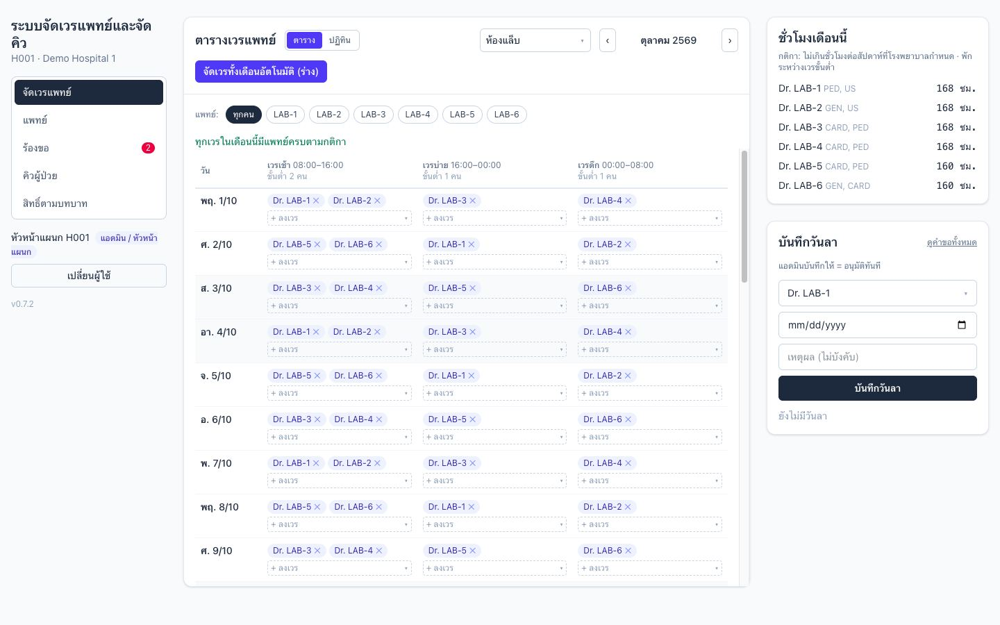 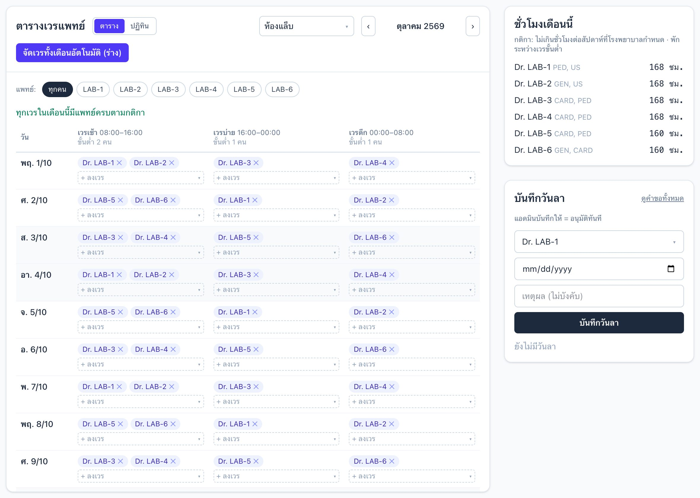

### 5.2 ตารางเวรรายเดือน (หัวหน้าแผนก)

ช่องสีแดง = คนไม่ครบ · กล่องส้ม "ต้องเลือก" = มีแพทย์อยากลงช่องนี้มากกว่าที่ต้องการ ระบบจึงไม่เลือกให้ กดชื่อเพื่อเลือก · ชิปแดง ⚠ = ลงเวรได้แต่ผิดกติกาแบบเตือน (ในภาพ Dr. OPD-3 พักไม่ถึง 8 ชม.) และชื่อในแผงชั่วโมงเป็นสีแดงด้วย · ชิปเขียว ✓ = ได้ตามที่อยากลง · ทุก dropdown ค้นหาได้ **เปิดดู:** [https://jitrudeedongdee.github.io/hospital-roster-queue/roster/table?dept=1&month=2027-01](https://jitrudeedongdee.github.io/hospital-roster-queue/roster/table?dept=1&month=2027-01) · ล็อกอินเป็น หัวหน้าแผนก

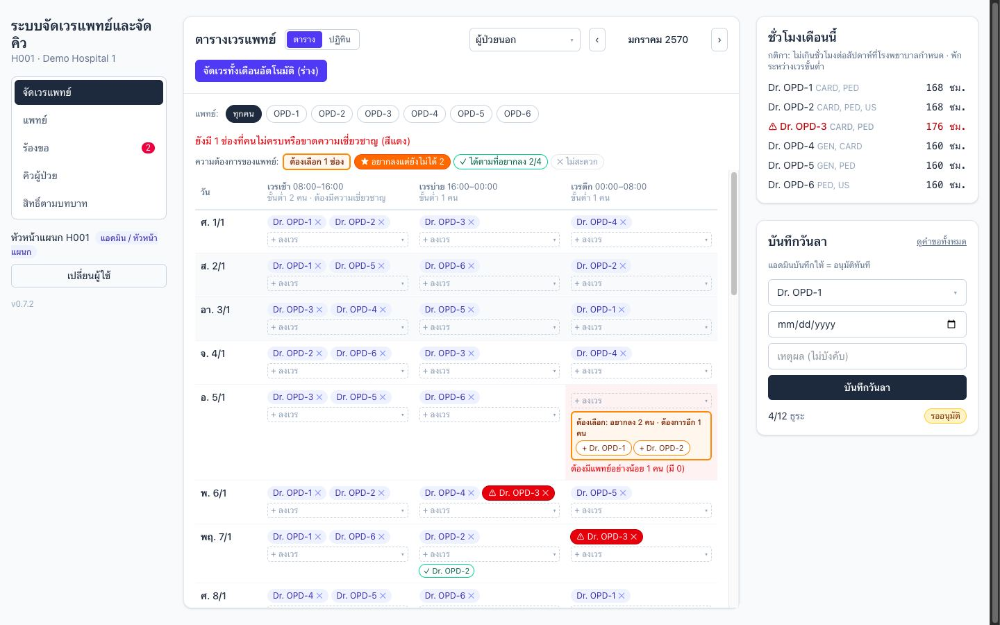 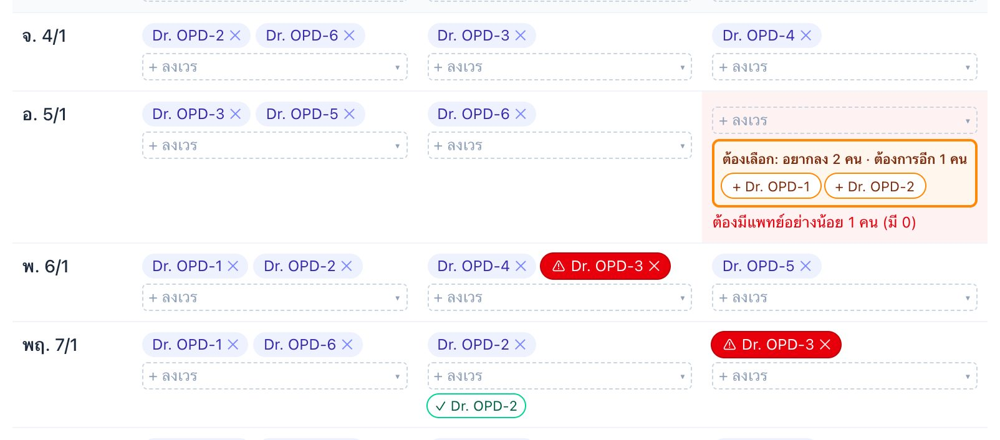

### 5.3 ปฏิทินเวร (ทุกคน)

ตัวกรองแพทย์ตัวเดียวกับตาราง สีตามช่วงเวร วันที่มีช่องขาดคนมีกรอบแดง **เปิดดู:** [https://jitrudeedongdee.github.io/hospital-roster-queue/roster/calendar?dept=1&month=2027-01](https://jitrudeedongdee.github.io/hospital-roster-queue/roster/calendar?dept=1&month=2027-01) · ล็อกอินเป็น หัวหน้าแผนก

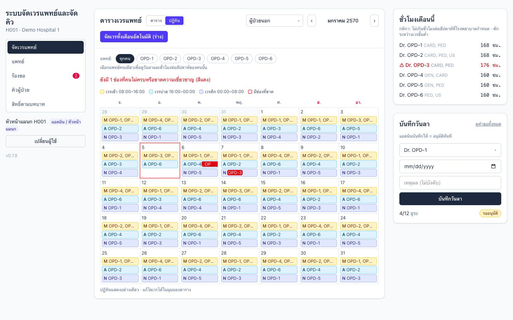 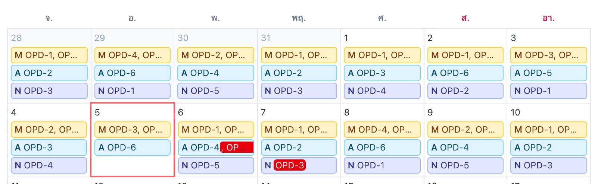

### 5.4 ปฏิทินเวรเมื่อเลือกแพทย์คนเดียว

สรุปเวรและชั่วโมงในเดือน วันลา และชั่วโมงต่อสัปดาห์เทียบเพดานทางขวา เวรที่ผิดกติกาเป็นสีแดง **เปิดดู:** [https://jitrudeedongdee.github.io/hospital-roster-queue/roster/calendar?dept=1&month=2027-01&doctors=3](https://jitrudeedongdee.github.io/hospital-roster-queue/roster/calendar?dept=1&month=2027-01&doctors=3) · ล็อกอินเป็น หัวหน้าแผนก

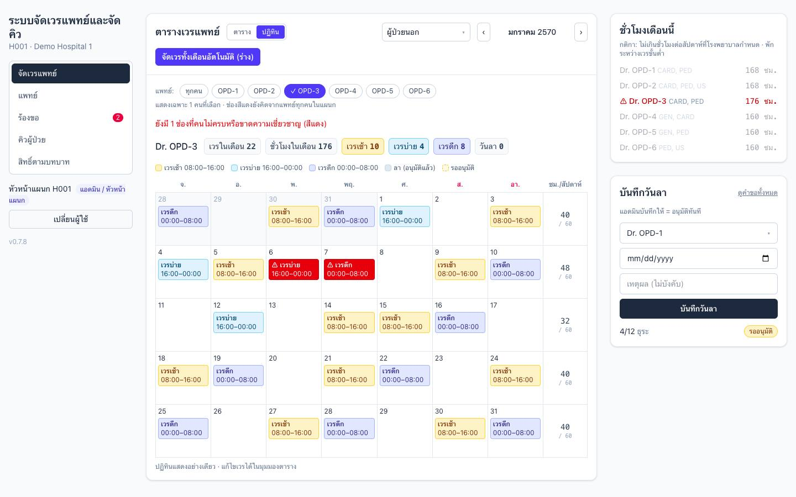 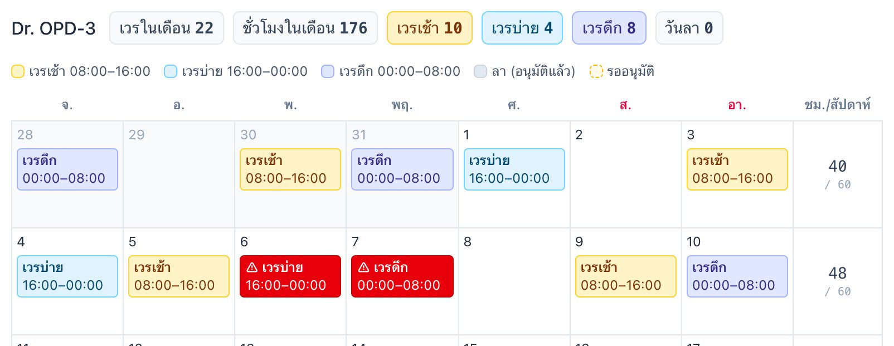

### 5.5 ร้องขอข้างตารางเวร (แพทย์)

แพทย์เห็นเวรของตัวเองเป็นสีเขียว คลิกชิปเวรที่ยังไม่เริ่มแล้วกล่อง "ร้องขอ" สลับไปแท็บขอย้าย/แลกเวรพร้อมเลือกเวรนั้นให้ เลือกแลกกับเพื่อนหรือย้ายไปช่องอื่นได้โดยยังเห็นตาราง **เปิดดู:** [https://jitrudeedongdee.github.io/hospital-roster-queue/roster/table?dept=1&doctors=1](https://jitrudeedongdee.github.io/hospital-roster-queue/roster/table?dept=1&doctors=1) · ล็อกอินเป็น Dr. OPD-1

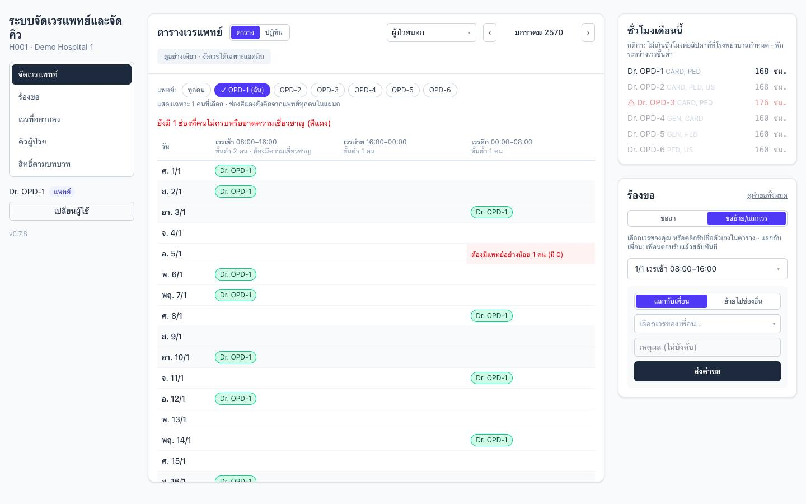 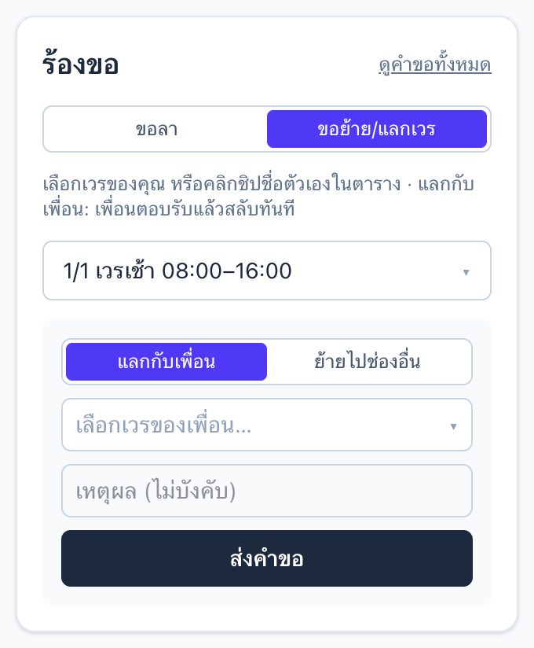

### 5.6 เวรที่อยากลง (แพทย์)

กดช่องเพื่อสลับ อยากลง / ไม่สะดวก · สรุปชั่วโมงรายสัปดาห์เทียบเพดาน เกินแล้วยังเลือกได้แต่เป็นสีแดง · วันที่ขอลาไว้เลือกไม่ได้ · ประวัติรายเดือนทางขวา กดเพื่อเปิดเดือนนั้น **เปิดดู:** [https://jitrudeedongdee.github.io/hospital-roster-queue/preferences?month=2026-12](https://jitrudeedongdee.github.io/hospital-roster-queue/preferences?month=2026-12) · ล็อกอินเป็น Dr. OPD-1

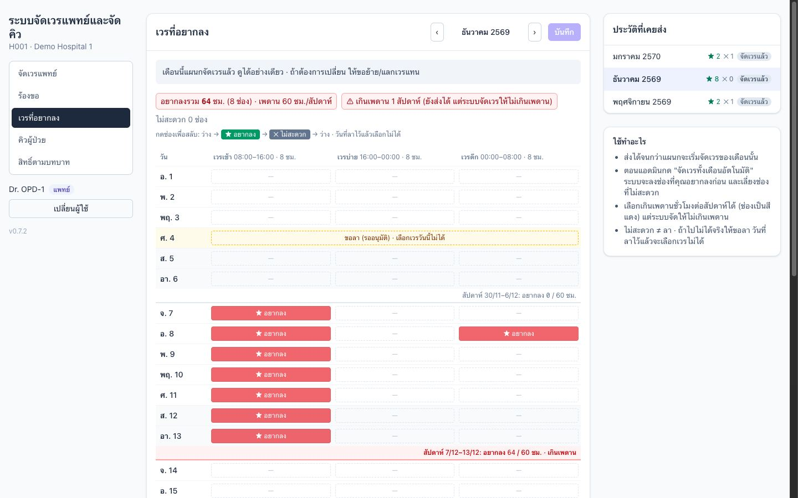 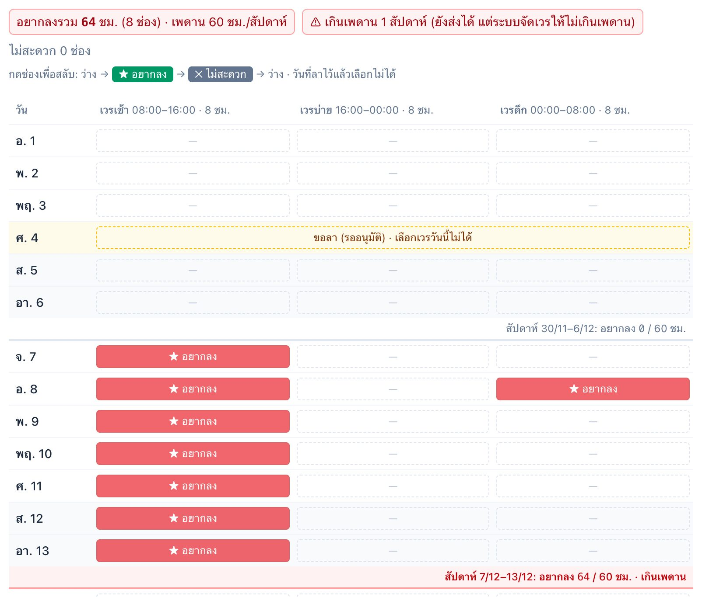

### 5.7 คำขอแลกเวรที่เพื่อนส่งมา (แพทย์ผู้ถูกขอ)

เห็นว่าเพื่อนขอแลกเวรไหนกับเวรไหน พร้อมปัญหาที่ระบบตรวจเจอล่วงหน้า ถ้าตอบรับและไม่ผิดกติกา ระบบสลับให้ทันที **เปิดดู:** [https://jitrudeedongdee.github.io/hospital-roster-queue/requests/shifts](https://jitrudeedongdee.github.io/hospital-roster-queue/requests/shifts) · ล็อกอินเป็น Dr. OPD-2

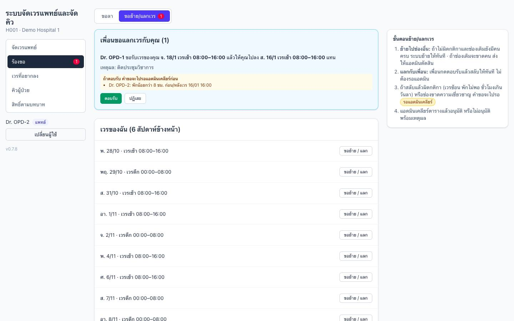 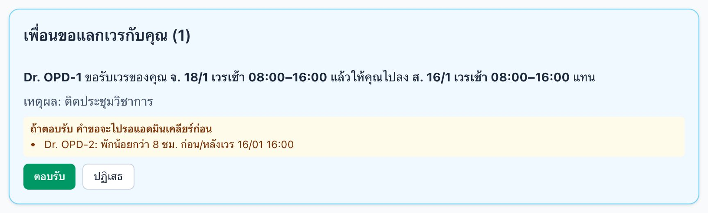

### 5.8 คำขอที่รอหัวหน้าเคลียร์

คำขอแลกที่เพื่อนตอบรับแล้วแต่ผิดกติกา หัวหน้าเปิดตารางของแพทย์ที่เกี่ยวข้อง เคลียร์ แล้วอนุมัติ (ระบบไม่ให้อนุมัติถ้ายังผิดกติกา) หรือไม่อนุมัติพร้อมหมายเหตุ **เปิดดู:** [https://jitrudeedongdee.github.io/hospital-roster-queue/requests/shifts](https://jitrudeedongdee.github.io/hospital-roster-queue/requests/shifts) · ล็อกอินเป็น หัวหน้าแผนก

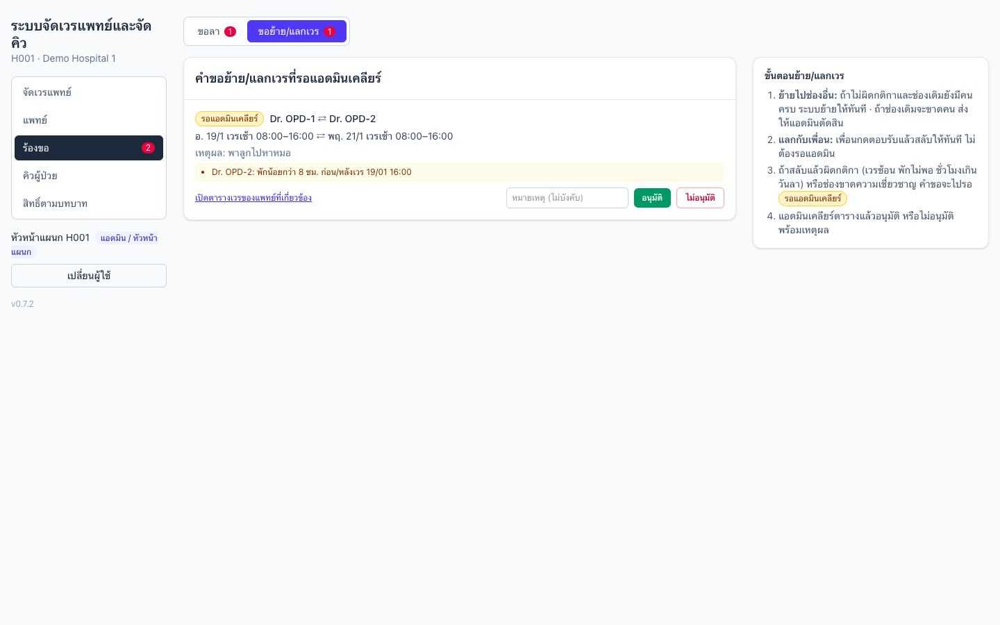 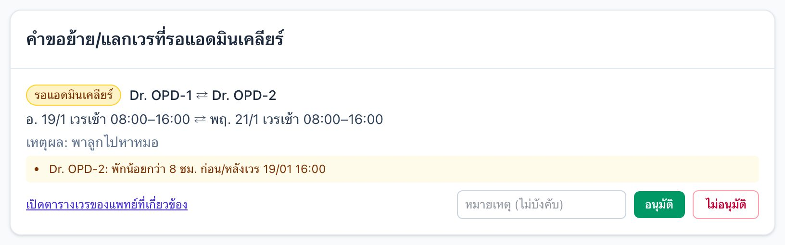

### 5.9 คำขอลา (หัวหน้าแผนก)

กล่องคำขอแยกตามสถานะ ถ้าวันนั้นแพทย์มีเวรอยู่ ระบบเตือนให้ย้ายเวรก่อนและปุ่มอนุมัติกดไม่ได้ **เปิดดู:** [https://jitrudeedongdee.github.io/hospital-roster-queue/requests/leave](https://jitrudeedongdee.github.io/hospital-roster-queue/requests/leave) · ล็อกอินเป็น หัวหน้าแผนก

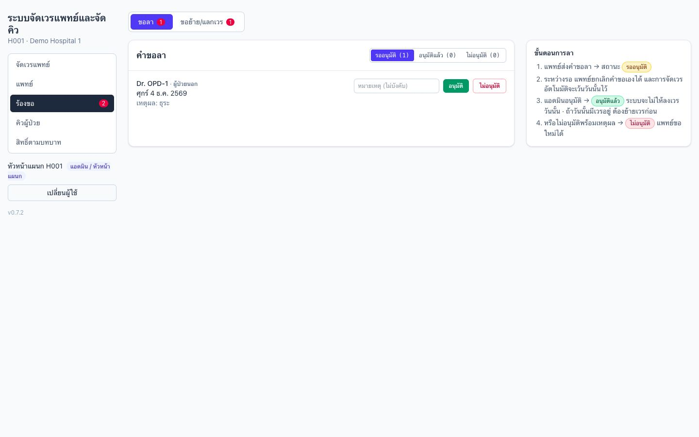 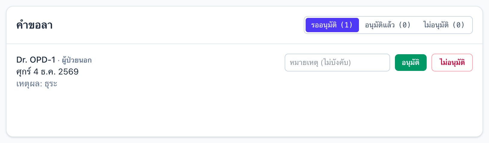

### 5.10 รายการคิว (พยาบาลคัดกรอง)

เลขคิวตัวเลขล้วน หลักแรกบอกแผนก · พยาบาลแก้ความเร่งด่วนและความเชี่ยวชาญของคิวที่รอเรียกได้ในแถว · คอลัมน์แพทย์บอกแพทย์ที่อยู่เวรตอนนี้และรับคิวนั้นได้ ถ้าไม่มีใครรับได้ขึ้นสีแดง · ค้นหาเลขคิวและกรองความเร่งด่วน/แพทย์ได้ **เปิดดู:** [https://jitrudeedongdee.github.io/hospital-roster-queue/queue/list](https://jitrudeedongdee.github.io/hospital-roster-queue/queue/list) · ล็อกอินเป็น พยาบาลคัดกรอง

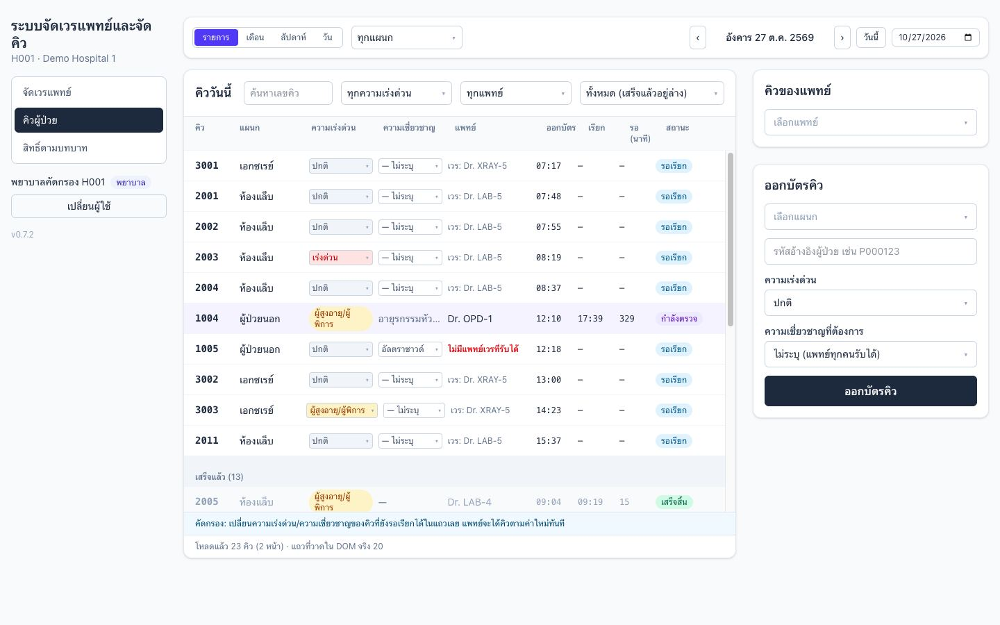 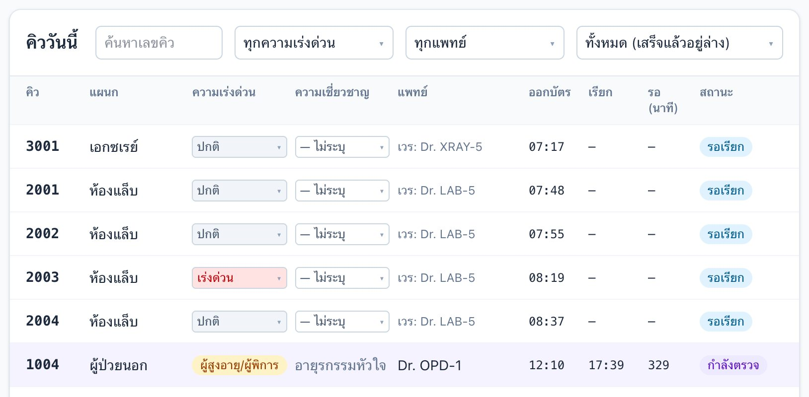

### 5.11 ห้องตรวจของแพทย์

คิวปัจจุบัน (กำลังตรวจ) พร้อมเวลาที่เรียก ปุ่มเรียกคิวถัดไปกดไม่ได้จนกว่าจะกดเสร็จสิ้น · กล่องคิวถัดไป · ในรายการ คิวที่กำลังตรวจเป็นสีม่วง คิวที่เสร็จแล้วเป็นสีเทาอยู่ด้านล่าง **เปิดดู:** [https://jitrudeedongdee.github.io/hospital-roster-queue/queue/list](https://jitrudeedongdee.github.io/hospital-roster-queue/queue/list) · ล็อกอินเป็น Dr. OPD-1

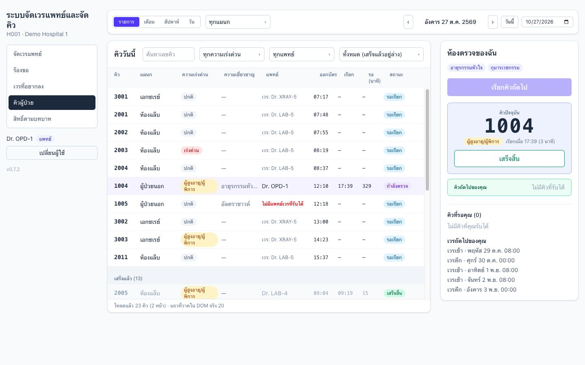 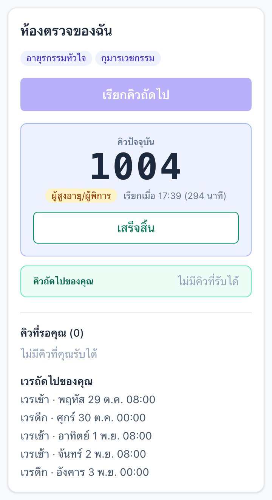

### 5.12 dropdown ที่ค้นหาได้

ใช้ทุกจุดในระบบ พิมพ์เพื่อกรอง (ในภาพพิมพ์ "LAB") ใช้ลูกศร/Enter ได้ รายการสูงไม่เกิน 240px แล้วเลื่อนในกล่อง **เปิดดู:** [https://jitrudeedongdee.github.io/hospital-roster-queue/queue/list](https://jitrudeedongdee.github.io/hospital-roster-queue/queue/list) · ล็อกอินเป็น พยาบาลคัดกรอง

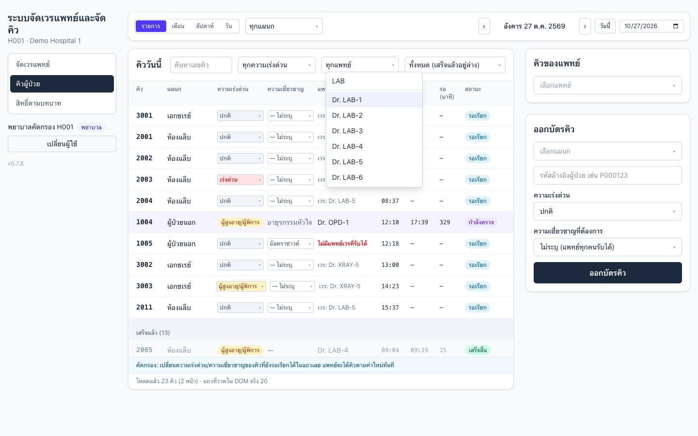 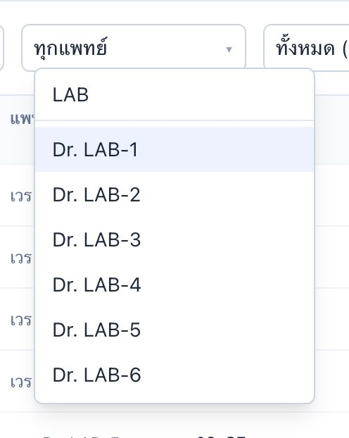

### 5.13 ปฏิทินคิวรายเดือน

จำนวนคิว เสร็จแล้ว และเวลารอเฉลี่ยต่อวัน สีเข้มตามความหนาแน่น วันที่ผ่านมาอ่านจากตารางสรุปรายวัน วันนี้นับสด **เปิดดู:** [https://jitrudeedongdee.github.io/hospital-roster-queue/queue/month](https://jitrudeedongdee.github.io/hospital-roster-queue/queue/month) · ล็อกอินเป็น พยาบาลคัดกรอง

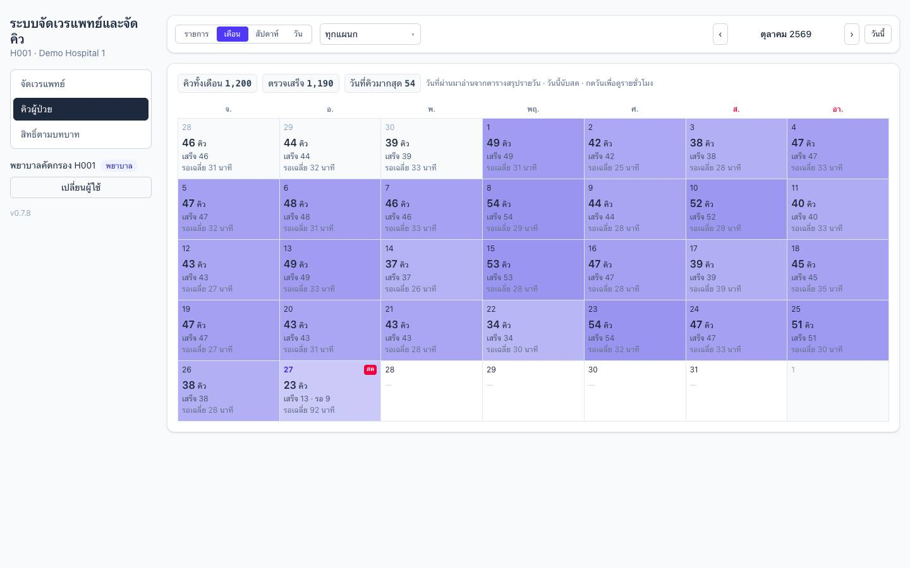 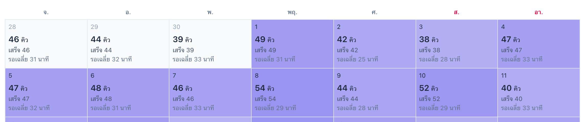

### 5.14 ปฏิทินคิวรายสัปดาห์

ตารางวัน × ชั่วโมงของคิวที่ออก เห็นช่วงเวลาที่คนไข้หนาแน่น **เปิดดู:** [https://jitrudeedongdee.github.io/hospital-roster-queue/queue/week](https://jitrudeedongdee.github.io/hospital-roster-queue/queue/week) · ล็อกอินเป็น พยาบาลคัดกรอง

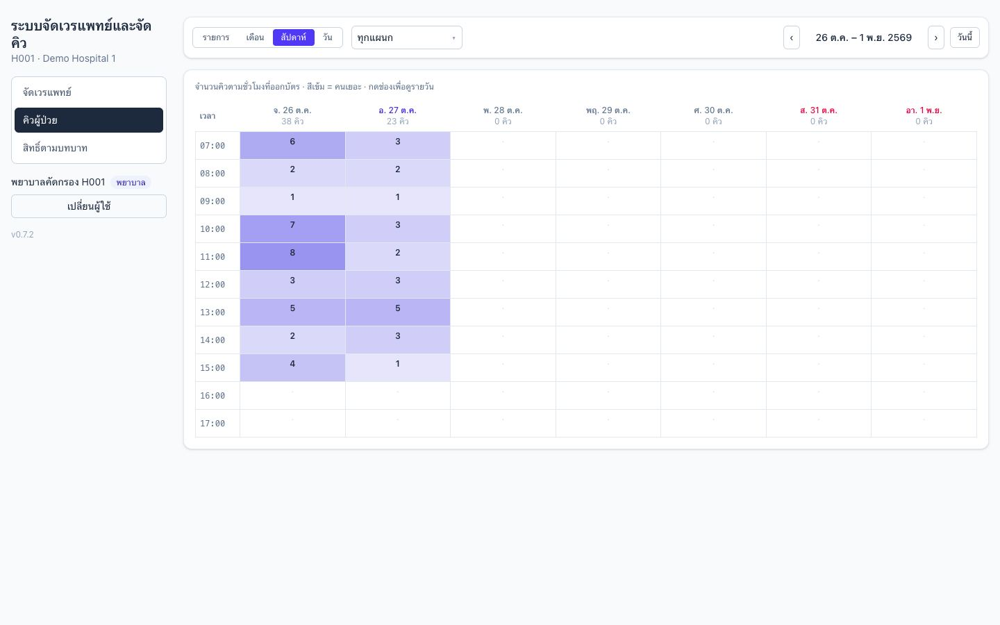 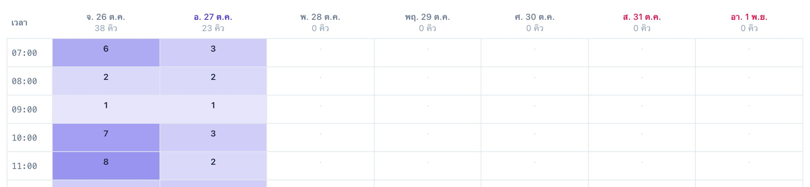

### 5.15 หน้าแพทย์ (หัวหน้าแผนก)

แพทย์ทุกคนพร้อมความเชี่ยวชาญ เวรและชั่วโมงเดือนนี้ เวรถัดไป คำขอลาที่รอ · คลิกชื่อเพื่อแก้ชื่อและความเชี่ยวชาญ · เพิ่มแพทย์ใหม่พร้อมบัญชีผู้ใช้ **เปิดดู:** [https://jitrudeedongdee.github.io/hospital-roster-queue/staff?id=2](https://jitrudeedongdee.github.io/hospital-roster-queue/staff?id=2) · ล็อกอินเป็น หัวหน้าแผนก

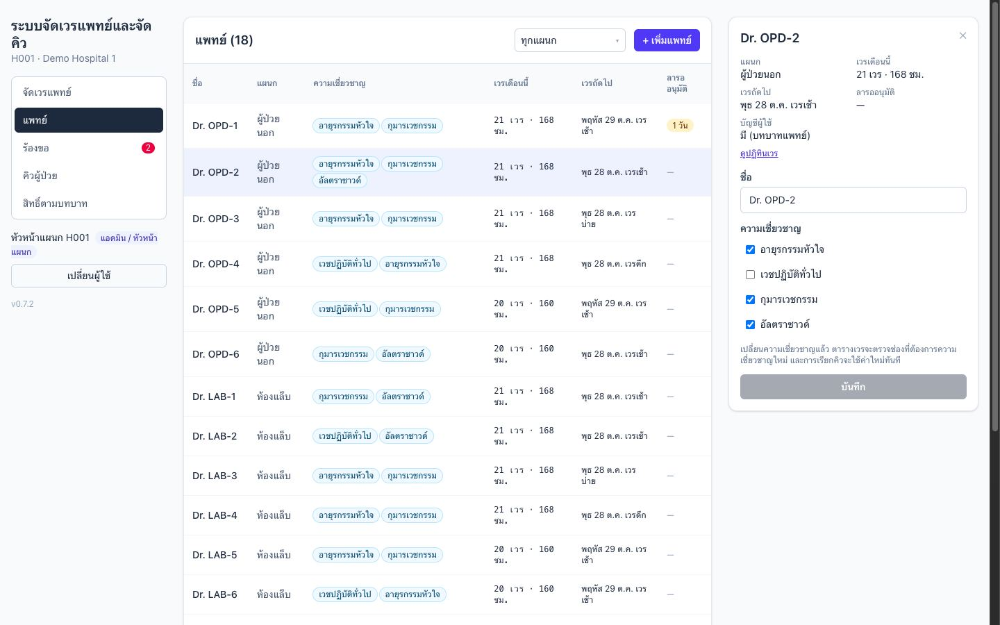 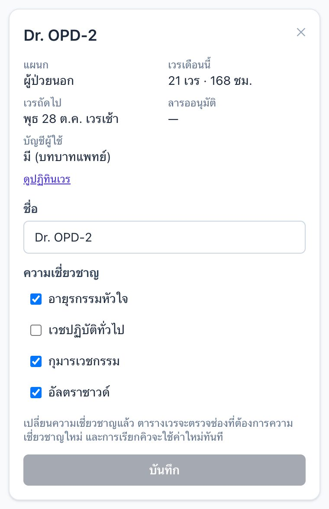

### 5.16 สิทธิ์ตามบทบาท

ตารางสิทธิ์จาก `App\Enums\Role` ตัวเดียวกับที่ backend ใช้ตรวจทุก request **เปิดดู:** [https://jitrudeedongdee.github.io/hospital-roster-queue/roles](https://jitrudeedongdee.github.io/hospital-roster-queue/roles) · ล็อกอินเป็น ทุกบทบาท

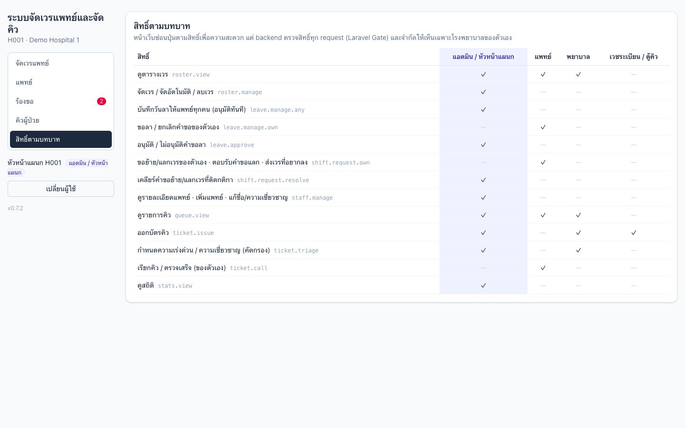 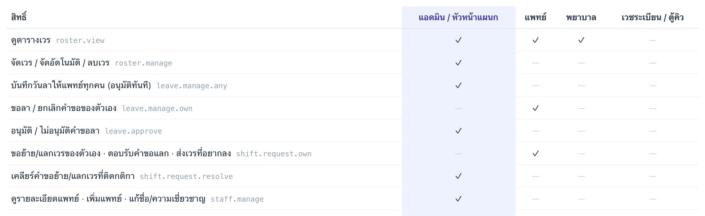
